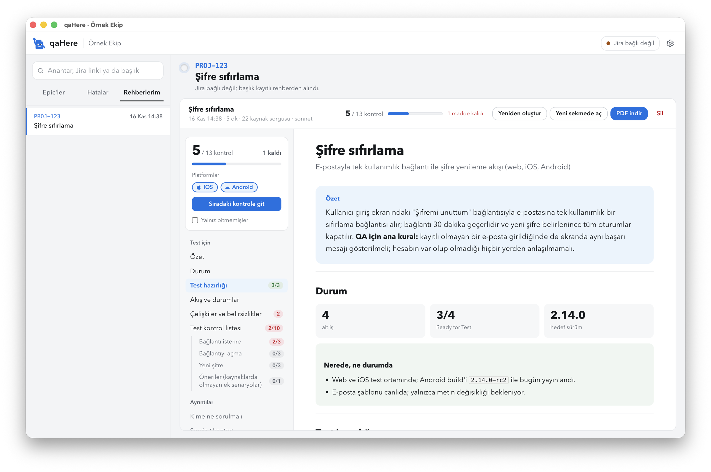
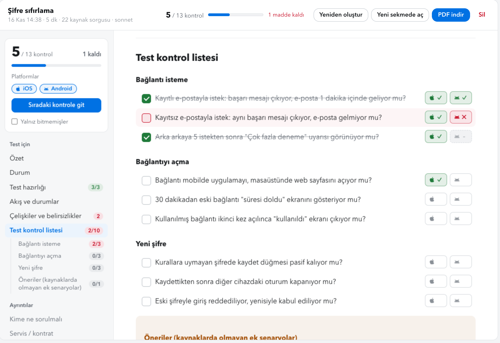
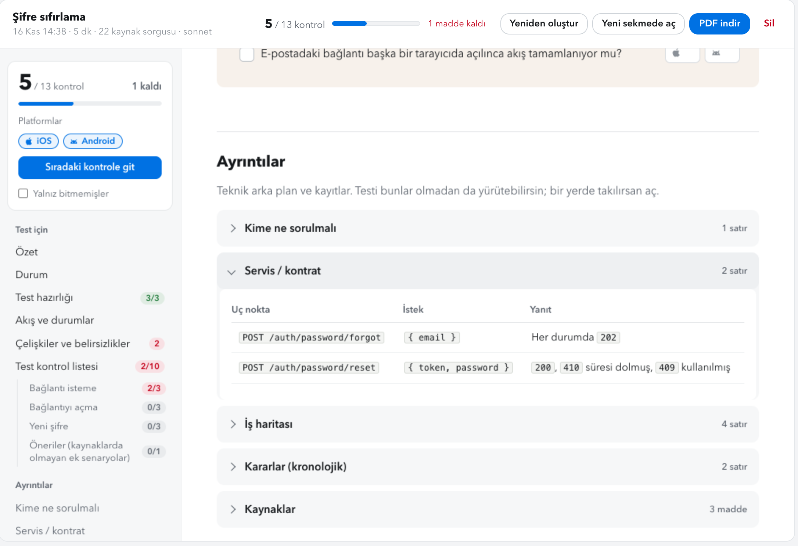
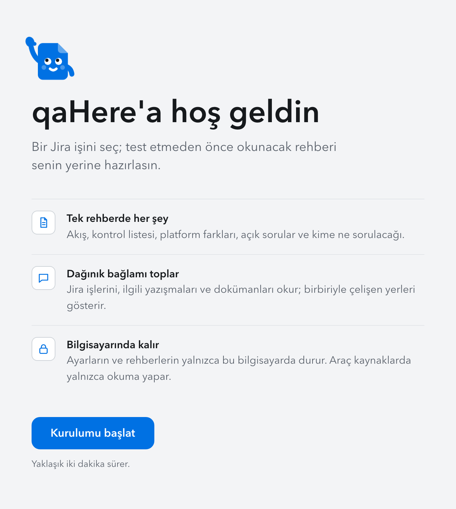
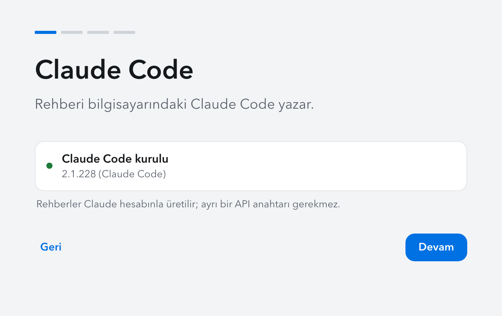
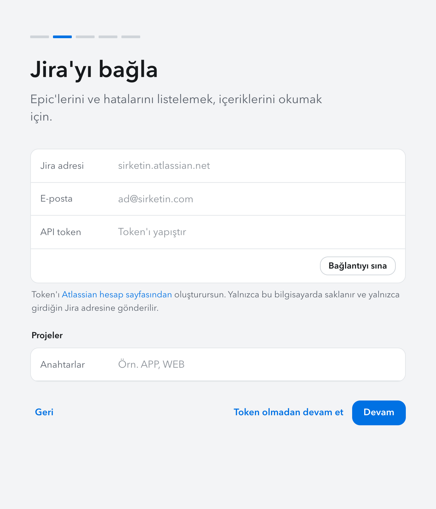
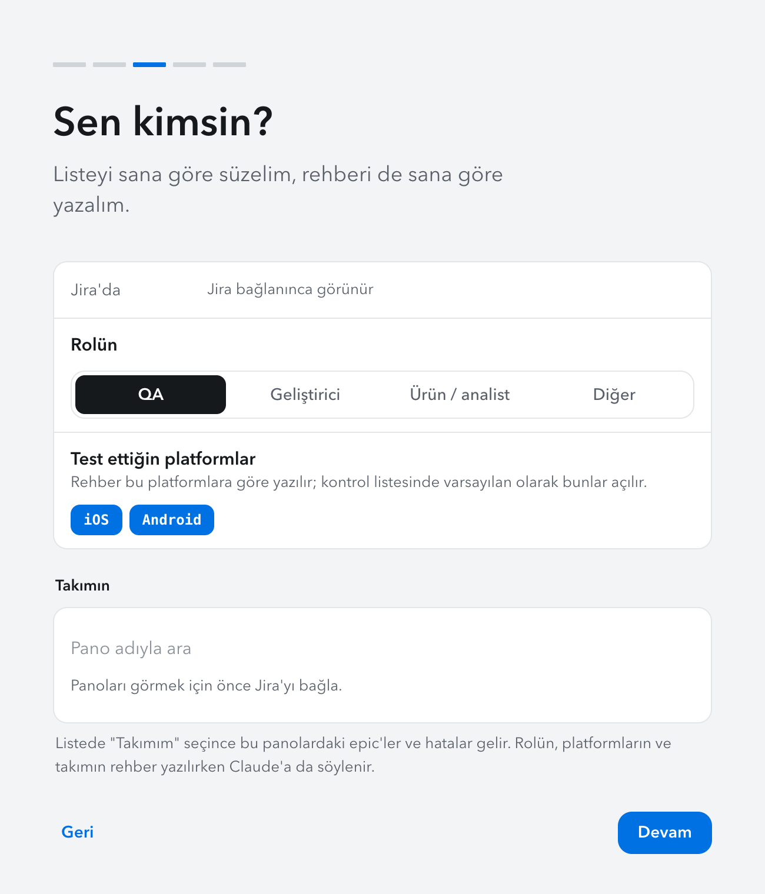
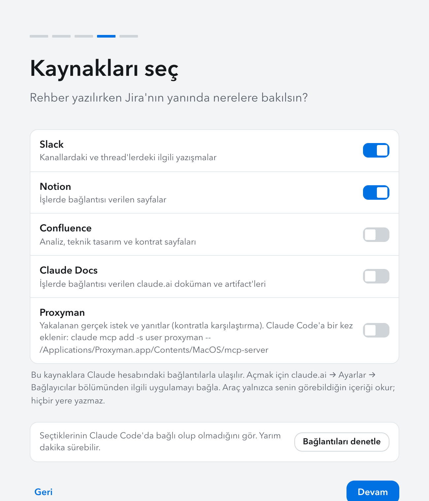
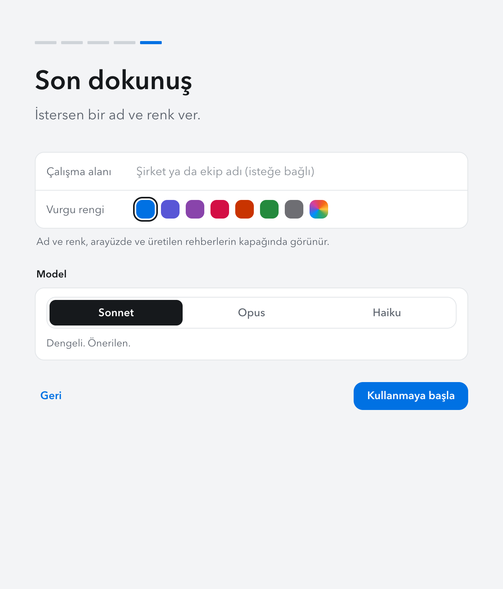
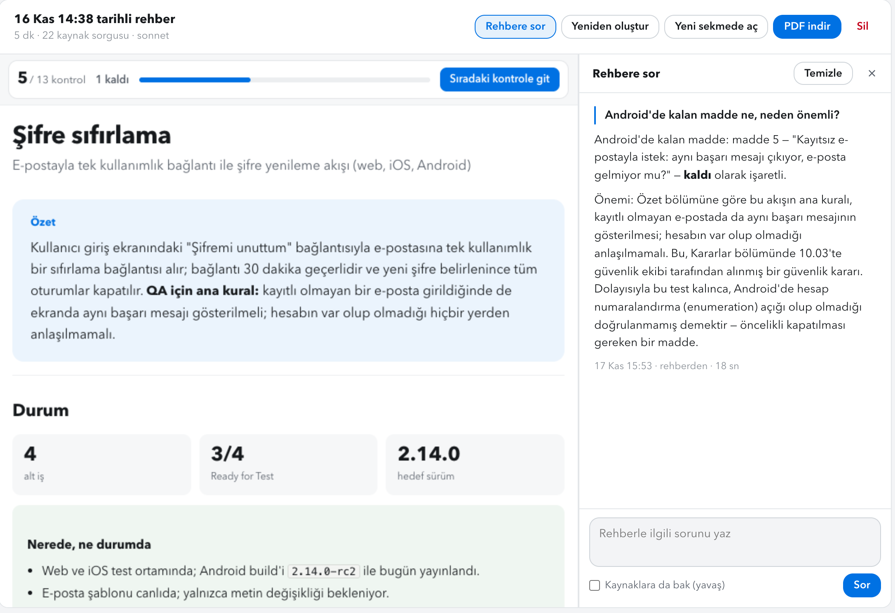

<p align="center">
  
</p>

<h1 align="center">qaHere</h1>

<p align="center">
  Turns a Jira issue into the <b>QA guide</b> a tester reads before testing.<br>
  Runs as an app on your Mac and writes the guide with your own Claude account.
</p>

<p align="center">
  <a href="README.md">Türkçe</a> · <b>English</b>
</p>

<p align="center">
  
</p>

> **Language note:** the app's interface and the guides it writes are currently **Turkish only**. The screenshots below show the Turkish UI; each one is described in English.

---

## What it does

Pick an epic or a task. qaHere reads the Jira issue and its sub-tasks, related Slack threads, and Notion and Confluence pages. Then it writes a guide in the order a tester needs it:

- **Preparation first:** a summary and the main rule for QA, which platform is at which stage; then **environment setup** (which build, which devices, test accounts and data, ready-made **mock responses** when needed), test preparation and **contradictions** between sources. The tests come after preparation is done.
- **Test checklist:** screen by screen. Mark each item **Passed**, **Failed** or **Not applicable** separately for iOS and Android; once every platform is done, the item is struck through. If Notion or Jira has an event plan, **analytics events** appear letter for letter (with parameters and when they fire) in their own table and in the checklist. Marks are saved instantly; close the tab, come back, and they are still there. They also show up in the PDF.
- **Details:** service contract and error codes, automation IDs, a timeline of decisions, the issue map, who to ask what, and the sources that were read. Nothing is left out, but these sit in collapsed sections; you can run the tests without them.

<table>
  <tr>
    <td width="50%"></td>
    <td width="50%"></td>
  </tr>
  <tr>
    <td>Checklist: pick a result from the iOS / Android button on the right of each item; the box on the left marks it passed everywhere. The left column shows how many items are done and how many failed in each section; <b>Go to next check</b> jumps to the first unfinished item.</td>
    <td>Technical details at the bottom, in collapsed rows. Open them when you get stuck.</td>
  </tr>
</table>

You can download the guide as a **PDF** or open the full report in a **new tab**; both contain every section in order.

---

## Installation

Takes about 5 minutes. Go step by step; each step tells you what you should see when it's done.

### 1. Check the requirements

| What | Why | How to check |
| --- | --- | --- |
| macOS | The desktop app (on Windows / Linux it runs in the browser) | – |
| Node.js 18 or later | Runs qaHere | `node --version` |
| Claude Code | Writes the guide | `claude --version` |
| A paid Claude account | Claude Code sign-in and source connectors | – |
| Chrome or Edge | Creates PDFs (otherwise print from the browser) | – |
| [Maestro](https://maestro.dev) + Xcode / Android SDK | Optional: run an item on a simulator | `maestro --version` |
| [Proxyman](https://proxyman.com) (macOS) | Optional: requests and mocks | – |

If you don't have Node, install the LTS version from <https://nodejs.org>.

### 2. Install Claude Code and sign in

macOS / Linux:

```bash
curl -fsSL https://claude.ai/install.sh | bash
```

Windows (PowerShell):

```powershell
irm https://claude.ai/install.ps1 | iex
```

Then run it once in a terminal and sign in with your Claude account:

```bash
claude
```

✅ This step is done when `claude --version` prints a version number.

### 3. Connect the sources to your Claude account

For the guide to read Slack, Notion, Confluence, Figma or Claude Docs, those connectors must be enabled on your Claude account.

1. Open <https://claude.ai> → **Settings → Connectors**.
2. Connect the ones you'll use: **Slack**, **Notion**, **Figma**, and **Atlassian** for Confluence. Approve the permission screen.

You can also type `/mcp` inside `claude` in a terminal and sign in to the same connectors there. In some companies an admin has to approve a connector first.

**Proxyman (optional, macOS):** If you want the guide to read captured traffic too, add Proxyman's MCP server to Claude Code once, then turn Proxyman on under Settings → Sources:

```bash
claude mcp add -s user proxyman -- /Applications/Proxyman.app/Contents/MacOS/mcp-server
```

Attaching requests to bugs and setting up mocks don't need this step; qaHere talks to Proxyman directly.

**Your other connectors:** Settings → Sources → **Diğer Claude bağlantıların** (Your other Claude connectors) → *Bağlantılarımı getir* (Load my connectors). It lists the connectors on your Claude account (Google Sheets, Drive, Calendar, Linear, Miro…); when you turn one on, qaHere reads that connector's tools, enables only the read tools and shows which are on and which stay off (e.g. Google Sheets: `get_values` on, `update_values` off). They're consulted when relevant while generating guides and in Ask the guide / Bugbot.

> qaHere only reads content **you** can see. Private channels you're not a member of never end up in a guide. It never writes to any source.

### 4. Download and install qaHere

```bash
git clone https://github.com/yunusemreyildiz/qahere.git
```

```bash
cd qahere && npm install
```

Then install the app:

```bash
npm run desktop
```

✅ This takes a few minutes (Electron is downloaded). At the end **qaHere** opens in its own window. From then on you don't need the terminal: open it from Launchpad, Spotlight (⌘ Space → "qaHere") or the Dock icon if you pin it.

On first launch macOS may ask *"qaHere would like to access files in your Documents folder"*. Click **Allow**; qaHere runs the code from the folder you downloaded.

<details>
<summary>About the desktop app</summary>

- The app starts the server itself and stops it when you quit (⌘Q). Closing the window keeps qaHere in the Dock; if a guide is being generated, it asks before quitting.
- The code isn't copied into the app; it runs from the `qahere` folder you downloaded. That's why the **Güncelle** (Update) button updates the app too. If you move the folder, run `npm run desktop` again.
- PDFs are saved straight to Downloads; Jira and Slack links open in your default browser.
- The **Sunucu** (Server) menu has *Open in browser*, *Restart server* and *Show log*. If `npm start` is already running in a terminal, the app connects to it.
- Electron takes about 300 MB and is installed only into `desktop/`. To remove the app, move `~/Applications/qaHere.app` to the Trash.

</details>

<details>
<summary>On Windows or Linux (in the browser)</summary>

The desktop app is macOS-only for now. On other systems you use qaHere in the browser:

```bash
npm start
```

✅ Wait for `qaHere hazır → http://localhost:4310` in the terminal, then open <http://localhost:4310> in your browser. It runs as long as the terminal stays open.

</details>

### 5. Finish the first-run steps

On first launch, qaHere walks you through five short steps.

<table>
  <tr>
    <td width="50%"></td>
    <td width="50%"></td>
  </tr>
  <tr>
    <td><b>Welcome.</b> Press <i>Kurulumu başlat</i> (Start setup).</td>
    <td><b>Claude Code.</b> Checked automatically. If it's green, continue; if not, run the commands shown and press <i>Yeniden denetle</i> (Check again).</td>
  </tr>
  <tr>
    <td></td>
    <td></td>
  </tr>
  <tr>
    <td><b>Connect Jira.</b> Your Jira address (<code>yourcompany.atlassian.net</code>), your email and an API token. Create the token on your <a href="https://id.atlassian.com/manage-profile/security/api-tokens">Atlassian account page</a> with <i>Create API token</i> and paste it. <i>Bağlantıyı sına</i> (Test connection) lists the projects you can see; pick the ones you want in the list.</td>
    <td><b>Who are you?</b> Your role, the platforms you test and your team's Jira boards. With <i>Takımım</i> (My team) selected, the list is filtered to those boards, and Claude writes the guide for you. All optional; change them later in Settings.</td>
  </tr>
  <tr>
    <td></td>
    <td></td>
  </tr>
  <tr>
    <td><b>Choose sources.</b> Where should qaHere look besides Jira? Turn on the ones you connected in step 3. <i>Bağlantıları denetle</i> (Check connections) confirms they're really connected in Claude Code.</td>
    <td><b>Finishing touch.</b> Optionally pick a workspace name, an accent color and a model, then press <i>Kullanmaya başla</i> (Start using).</td>
  </tr>
</table>

**A Jira token is optional.** If you choose *Token olmadan devam et* (Continue without a token), the epic list and title search won't work, but you can still type an issue key (e.g. `PROJ-123`) and generate a guide. Claude then reads Jira through its Atlassian connector, which is a little slower.

You can change everything later under ⚙️ **Settings** in the top right. To check your setup from the command line:

```bash
npm run doctor
```

---

## Usage

1. Pick an **epic** from the list on the left or an open bug from the **Hatalar** (Bugs) tab, or type a key, a Jira link or a title in the search box and press Enter. Single tasks work too. The selector above the list switches between **Takımım** (My team: your chosen boards), **Benim** (Mine: assigned to you or reported by you) and **Projenin tümü** (Whole project).
2. Optionally add a **note** (e.g. "focus on error cases").
3. Press **Rehber oluştur** (Create guide). Progress shows line by line: which issue, which search, which page is being read. Usually takes 3–8 minutes.
4. When it's done, the guide fills the screen. Move between sections on the left and mark items per platform as you test. If the issue title starts with "iOS -" or "Android -", the guide asks only for that platform; change it under **Platformlar** (Platforms) in the left column.
5. Share it with **PDF indir** (Download PDF). Every guide is kept under **Rehberlerim** (My guides); if you regenerate one, older versions stay selectable in the toolbar.

One guide is generated at a time; wait for the first to finish or **cancel** it.

**Guides for bugs** are shorter and focus on something else: steps to reproduce, expected vs. actual, verifying the fix, and neighbouring flows the fix may have broken (regression). This format is picked automatically when the Jira issue type contains Bug, Defect or Hata.

**Who are you?** On first run (and in Settings) you pick your role, the platforms you test and your team's Jira boards. "Takımım" filters the list by those boards; your role and platforms are also passed to Claude when the guide is written. If you picked a single platform, the checklist is written for that platform.

### Finishing an epic one issue at a time

An epic guide has a **Test sırası** (Test order) section that tells you which issue to start with and why: what's testable, what unblocks the others and what's critical goes first; what's still in development or blocked goes last. The checklist follows the same order, issue by issue.

The **Şu anki iş** (Current issue) card in the guide's left column shows the next issue and its progress; **Sıradaki kontrole git** (Go to next check) takes you to its next open item. Once every item of an issue is marked (Passed, Failed or N/A) you move on to the next one; a failed item waiting for a fix doesn't hold up the order and shows as "1 kaldı" (1 failed) in the Test order list.

### Asking the guide

Anything you wonder about while reading, ask with **Rehbere sor** (Ask the guide) in the toolbar; the panel opens next to the guide so you keep reading.

<p></p>

- Claude answers knowing what the guide says and which checks you've marked, and names the section it relied on. Questions like "which items are still open?" work too. The answer starts in about 15–20 seconds.
- If you ask something the guide doesn't cover or something current ("what's this issue's status now?", "what does this button say in Figma?"), Claude searches Jira, Slack, Notion, Confluence and Figma read-only and links to what it found. Questions answered from the guide take 15–20 seconds; ones that need the sources can take a minute and use more.
- The conversation is saved with the guide; **Temizle** (Clear) deletes it. Each question counts against your Claude usage.

### Disabled-source warning

When you press **Rehber oluştur** (Create guide), qaHere first checks the links in the issue's Jira content (Claude Docs, Notion, Confluence, Figma, Slack, Google Sheets/Docs/Drive, Miro, Linear). If any of them is disabled, it asks before generating: **Aç ve başlat** (Enable and start) or **Kapalı kalsın, başlat** (Keep it off and start). That way you don't have to generate the guide a second time because a source was off.

### Filing a bug with Bugbot

If you run into a bug while testing, describe it to **Bugbot** in the toolbar ("on Android an unregistered email shows 'no account'"). Bugbot compares it with the expected behaviour in the guide (checking Jira, Slack, Notion and Figma if needed) and searches Jira for similar open bugs; if the guide says it's expected, it tells you why. If something is missing (build, steps, the error text) it asks at most two questions, then shows the bug draft as a card.

- Paste screenshots into the panel (⌘V); they aren't sent to Claude, they're attached to the bug.
- **Kaydı hazırla** (Prepare the bug) opens the usual preview window filled in; if a checklist item matches, the bug is linked to it. Nothing is filed until you confirm.
- If the Slack source is on, the preview has **Kayıt açılınca Slack'ten bana bildir** (Notify me on Slack) checked: once the bug is filed you get a "bug filed" message in your own Slack DM. qaHere writes the message; Claude's Slack connection only delivers it to you.

### Filing a bug

Pick **Kaldı** (Failed) from an item's platform button and the bug window opens:

1. Fill in **Ne oldu?** (What happened?). The expected behaviour comes from the item; add steps if you like.
2. Paste a screenshot (⌘V), drag one in, or grab it from the running device with **iOS simülatöründen al / Android emülatöründen al** (from the iOS simulator / Android emulator).
3. **Taslağı hazırla** (Prepare draft): Claude writes the title and description in a short call of a few seconds, with no tools.
4. Edit the title and text in the preview. Nothing is created until you press **Jira'da aç** (Open in Jira).

The new issue gets the screenshots attached, is linked to the guide's issue and, if configured, added to the active sprint. Its key appears next to the item and in the PDF. qaHere creates it with your Jira token, not Claude.

Project, issue type (Bug, Defect…), title format (e.g. `{platform} - {konu} Bug`), assignee per platform, sprint board and extra fields are set under **Ayarlar → Hata kaydı** (Settings → Bug filing). Without a token you still get the draft; copy it with **Metni kopyala** and file it by hand.

### Running on a simulator (Maestro)

Pick **iOS simülatöründe koş… / Android emülatöründe koş…** (Run on the iOS simulator / Android emulator) from an item's platform menu:

1. The first time, press **Claude yazsın** (Let Claude write it): Claude writes a short Maestro flow from the guide's automation IDs and flow steps (no tools, ~10 s). If it fails Maestro's syntax check, Claude fixes it once. The flow only checks what the item asks; it never taps irreversible actions such as send or confirm.
2. Review the flow and fix lines marked `# kontrol et` (check this) or `# TODO`, e.g. how to reach that screen. Flows are saved per item and platform.
3. **Koş** (Run): Maestro runs on the open simulator/emulator and its output streams live. Later runs don't use Claude.
4. On a pass, the item is marked passed for that platform. On a fail you get the failure summary and the last screenshot; **Hata kaydı aç** (File a bug) opens the bug window pre-filled with them.

Under **Ayarlar → Simülatörde koşu** (Settings → Simulator runs), enter the iOS bundle id, the Android package name and an optional **setup flow** (e.g. log in, dismiss dialogs). The setup flow runs right after `launchApp`; `${APP_ID}` is filled with your app id. Claude never explores the app, so token use is limited to one short call per flow.

### Proxyman: requests and mocks

With Proxyman running (your app's traffic going through it, and SSL Proxying on for HTTPS):

- **Attach a request to a bug:** in the bug window press **Proxyman'den istek ekle** (Add a request from Proxyman); the endpoint path from the item is pre-filled in the search. The request and response you pick are attached as `.txt`, with credentials such as tokens, cookies and Authorization hidden.
- **Test with a mock:** pick **Mock ile test et…** (Test with a mock) from an item's platform menu. Choose a captured request or type the URL, then provide the response in one of three ways:
  - reuse the captured response as is,
  - write the body yourself,
  - describe it ("coupon list comes back empty") and press **Claude üretsin** (Let Claude write it): Claude writes JSON in a short call with no tools, keeping the sample's schema; you can edit it before setting it up.

  If the guide's **Ortam hazırlığı** (Environment setup) section has a ready mock response, the **Proxyman'e kur** (Set up in Proxyman) button under it opens this window with the method, status code and body filled in; you only pick the request.

  **Proxyman'de kur** (Set up in Proxyman) creates a Map Local rule. While a mock is on, the toolbar shows **Mock açık (n)** (Mock on); turn it off or delete it from there. qaHere creates the rule, not Claude.

### Updating

qaHere checks GitHub for a new version when it opens and every half hour while it stays open. If there is one, a **Yeni sürüm var** (New version) window lists what changed; press **Güncelle** (Update) and qaHere downloads it and restarts itself. In the desktop app the window and menus update too; if needed, the app quits and reopens itself. Only when the underlying Electron is upgraded are you asked to run `npm run desktop` once. Your settings, guides and ticks stay as they are. To check by hand: top right, **Durum → Yeni sürümü denetle** (Status → Check for a new version).

> If you installed qaHere before this feature, update by hand once: stop qaHere (Ctrl+C), run `git pull` in its folder, then `npm start`. Later updates come from inside the app.

In-app updating only works for installs made with `git clone`. If you edited qaHere's files yourself, update with `git pull`.

---

## Settings

Settings are made in the UI and stored in `data/settings.json` (never committed).

| Setting | Description |
| --- | --- |
| Jira address, email, API token | For the list, search and pre-fetched data. Changing the address asks for the token again. |
| Projects | Jira projects shown in the left list |
| Sources | Slack, Notion, Confluence, Figma, Claude Docs, Proxyman; disabled sources are never read |
| Workspace, accent color | Shown in the UI and on the guide cover |
| Model | `sonnet` balanced, `opus` deeper, `haiku` lightest |

You can also provide the same values in a `.env` file (see `.env.example`); settings saved in the UI take precedence. Only available via `.env`:

| Variable | Default | Description |
| --- | --- | --- |
| `CLAUDE_BIN` | `claude` | Full path if the command isn't on PATH |
| `GENERATE_TIMEOUT_MIN` | `20` | Maximum time for one generation (minutes) |
| `PORT` | `4310` | UI port |
| `CHROME_BIN` | auto | Browser path for PDFs (if not found) |
| `CLAUDE_EXTRA_ALLOWED_TOOLS` | empty | Extra read-only tools if your connectors use different names |
| `PROXYMAN_MCP_BIN` | Proxyman's macOS path | If Proxyman's MCP server lives elsewhere |
| `MAESTRO_BIN` | `~/.maestro/bin/maestro` | If Maestro lives elsewhere |
| `QAHERE_UPDATE_CHECK` | on | Set to `off` to skip the new-version check |

**Cost:** qaHere is free and doesn't depend on any server. Each guide counts against the Claude usage of the person who generates it; how much depends on the size of the issue and the model.

---

## Customizing the guide

- **Content and sections:** `prompts/rehber.md` (shared rules), `prompts/bolumler-ozellik.md` and `prompts/bolumler-hata.md` (sections of the feature and bug guides). Add sections, change the order, tighten the research rules. No restart needed.
- **Guide and PDF look:** `templates/guide.css`.
- **In-app guide layout** (section order, left column, collapsed sections): `public/viewer.js` and `public/viewer.css`.
- **Sources:** `READ_TOOLS` in `lib/generate.js`. **Only add read-only tools.**

---

## Troubleshooting

| Symptom | Fix |
| --- | --- |
| "Claude Code bulunamadı" (not found) | Does `claude --version` work? If not, repeat step 2. If it works but qaHere can't find it, add `CLAUDE_BIN=/full/path/claude` to `.env` (`which claude`). |
| "Jira'ya bağlanılamadı" (can't connect) | Check the address, email and token in Settings and press *Test connection*. |
| Epic list is empty | Is a project selected in Settings? Do you have access to that project? |
| The guide says a source couldn't be read | Top right: **Durum → Bağlantıları denetle** (Status → Check connections). If it says sign-in is required, repeat step 3. |
| "Claude didn't produce a guide in the expected format" | Try again. If it persists, open `claude` in a terminal and make sure you're signed in. |
| Time limit reached | Very large epic. Increase `GENERATE_TIMEOUT_MIN` or generate per sub-task. |
| The desktop app stays on "qaHere açılıyor" (starting) | macOS's folder-access prompt may be hidden behind it: click **Allow**, or enable qaHere under System Settings → Privacy & Security → Files and Folders. Otherwise check **Sunucu → Günlüğü göster** (Server → Show log). |
| PDF doesn't download | Chrome/Edge isn't installed. *Open in new tab* → Print → Save as PDF. |
| Port in use | Set `PORT=4311` in `.env`. |

---

## Limitations

- **Jira Cloud** only (no Jira Server / Data Center).
- The UI and the generated guides are **Turkish only** for now.
- Issue trackers other than Jira aren't supported.

---

## Security and privacy

- The server listens on `127.0.0.1` only and accepts requests only from a browser on the same computer.
- Claude gets **read-only** tools. Sending messages, creating or editing issues, writing files, running commands and web access are all disabled. Writing a bug draft gets no tools at all.
- The only thing that writes to Jira is bug filing: after you review the preview and press **Jira'da aç**, qaHere creates the issue with your token.
- The Jira token is never sent back to the UI and goes only to the Jira address you entered; it's deleted if the address changes.
- The guide is shown with scripts stripped, inside a sandboxed frame. The only script allowed to run there is qaHere's own viewer, added fresh on every open.
- Settings, token, guides and ticks stay on your computer (`data/` and `.env`; neither is committed).
- **Read the guide before sharing it.** It may quote private channels you have access to.
- The guide is compiled automatically and can be wrong or incomplete. Confirm critical items with the right person before testing.

---

## Project structure

```
qahere/
├── bin/qahere.js        Launcher (restarts the server after an update)
├── server.js            Express server, generation jobs, archive, ticks, PDF
├── lib/
│   ├── config.js        Settings (data/settings.json, .env as fallback)
│   ├── jira.js          Jira REST client (read-only)
│   ├── generate.js      Runs Claude Code in the background, cleans the output
│   ├── bug.js           Bug drafts and filing in Jira
│   ├── ask.js           Ask the guide and Bugbot (chat, no tools)
│   ├── notify.js        Slack notice to yourself for Bugbot bugs
│   ├── notion.js        Reads publicly shared Notion pages
│   ├── proxyman.js      Proxyman: requests and mock rules
│   ├── runner.js        Writing and running Maestro flows
│   ├── device.js        Finding simulators/emulators, screenshots
│   ├── pdf.js           PDF via Chrome/Edge
│   └── store.js         Guide archive and checklist ticks (data/guides)
├── prompts/rehber.md    Instructions for how the guide is written (sections: bolumler-ozellik.md, bolumler-hata.md)
├── templates/guide.css  Guide and PDF styles
├── desktop/             macOS desktop app (Electron shell, npm run desktop)
├── public/              UI (dependency-free HTML/CSS/JS) and the guide viewer
├── docs/                README images
└── data/                Settings and generated guides (never committed)
```

License: MIT. The issues and people in the screenshots are made up.
