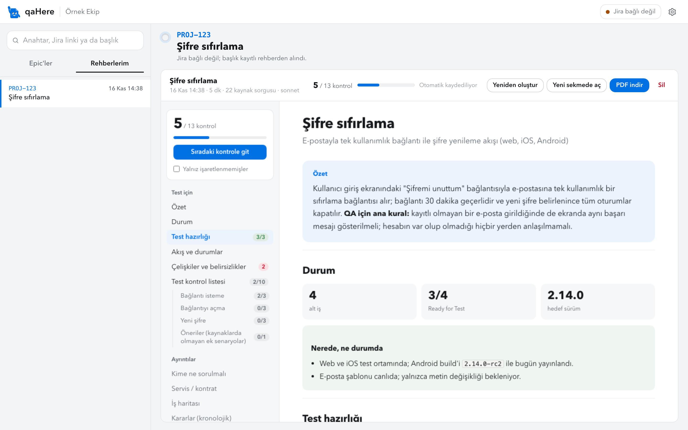
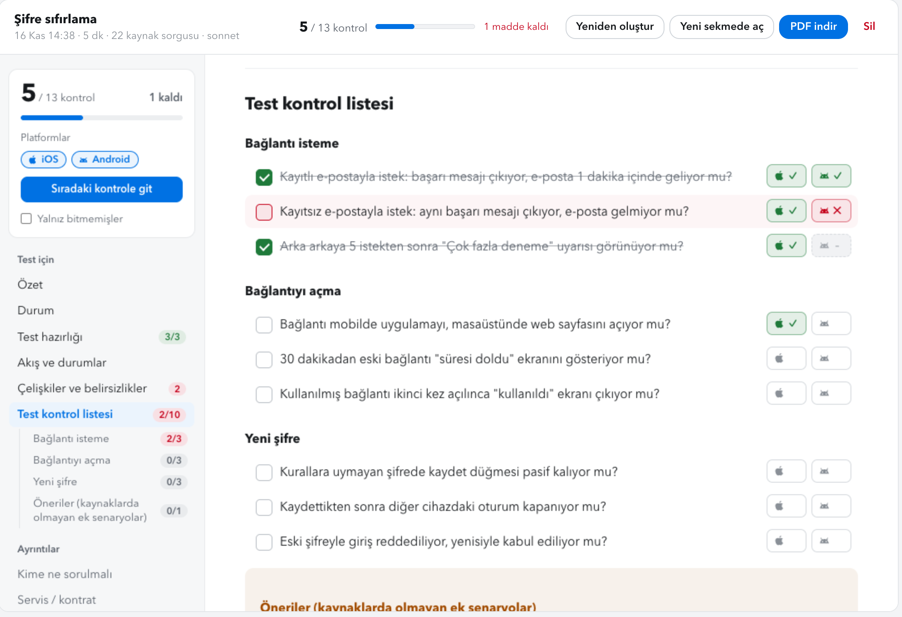
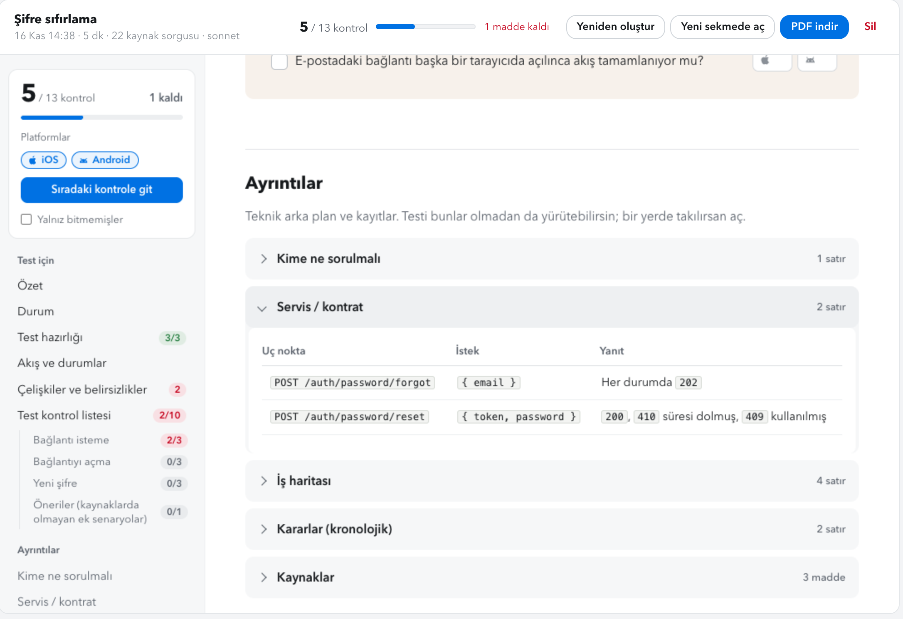
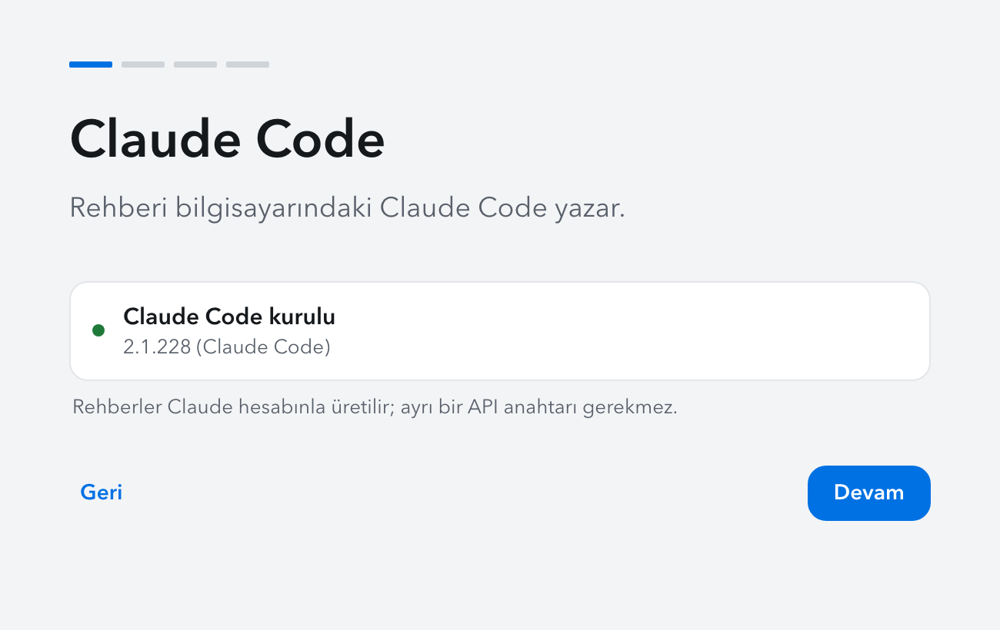
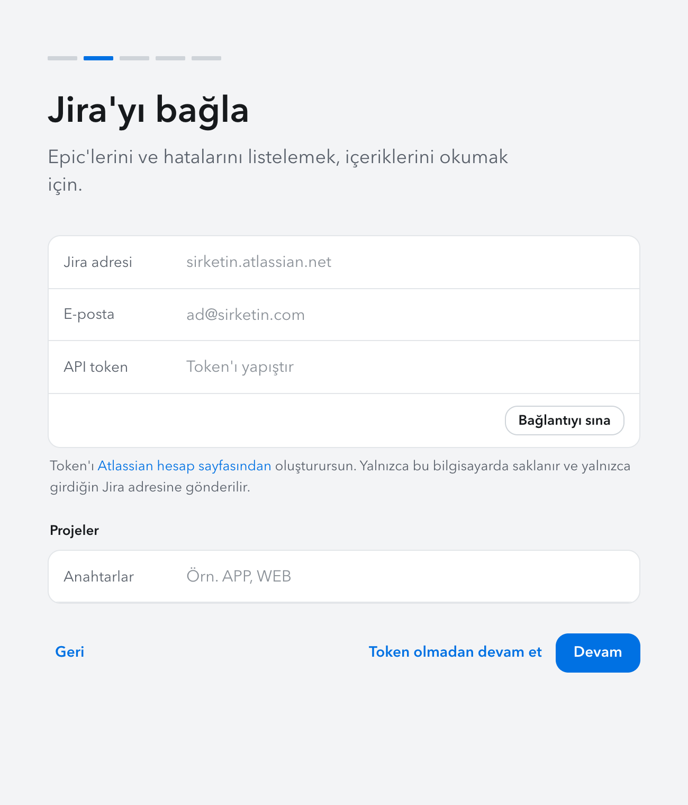
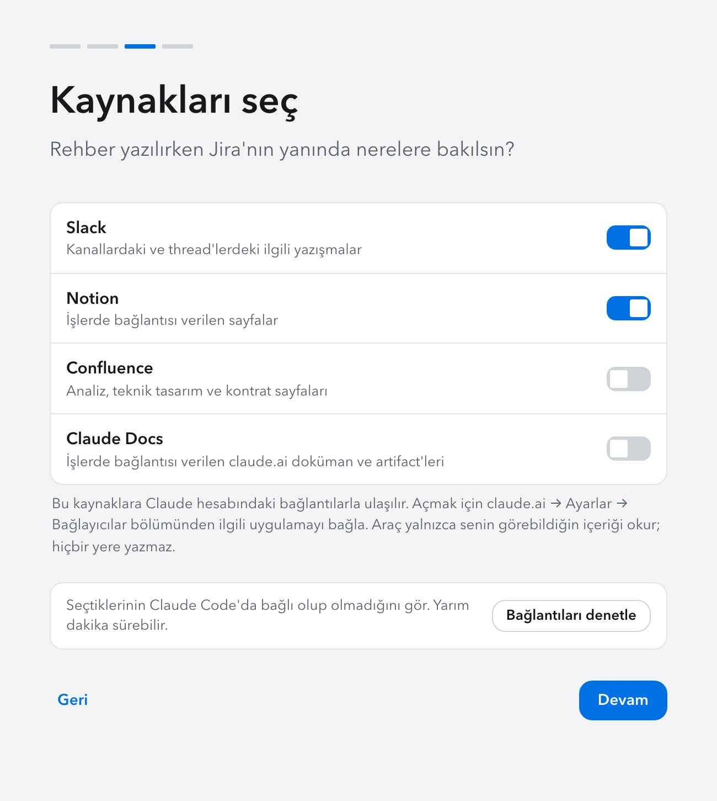

<p align="center">
  
</p>

<h1 align="center">qaHere</h1>

<p align="center">
  Jira işinden, test etmeden önce okunacak <b>QA rehberini</b> hazırlar.<br>
  Bilgisayarında çalışır, rehberi kendi Claude hesabınla yazar.
</p>

<p align="center">
  <b>Türkçe</b> · <a href="README.en.md">English</a>
</p>

<p align="center">
  
</p>

---

## Ne yapar?

Bir epic ya da task seçersin. qaHere Jira işini ve alt işlerini, ilgili Slack yazışmalarını, Notion ve Confluence sayfalarını okur. Sonra QA'nın ihtiyaç duyduğu sırayla bir rehber yazar:

- **Önce bilmen gerekenler:** özet ve QA için ana kural, hangi platform hangi aşamada, test hazırlığı, akış adımları, kaynaklar arasındaki **çelişkiler**.
- **Test kontrol listesi:** ekran ekran maddeler. Her maddeyi iOS ve Android için ayrı ayrı **Geçti**, **Kaldı** ya da **Uygulanmaz** diye işaretlersin; tüm platformlarda bitince maddenin üstü çizilir. İşaretler anında kaydedilir; sekmeyi kapatıp geri geldiğinde yerinde durur, PDF'e de yansır.
- **Ayrıntılar:** servis kontratı ve hata kodları, otomasyon id'leri, kararların kronolojisi, iş haritası, kime ne sorulacağı, okunan kaynaklar. Hiçbiri atlanmaz, ama kapalı bölümlerde durur; testi bunları bilmeden de yürütebilirsin.

<table>
  <tr>
    <td width="50%"></td>
    <td width="50%"></td>
  </tr>
  <tr>
    <td>Kontrol listesi: maddenin sağındaki iOS / Android düğmesinden sonucu seç; soldaki kutu "her yerde geçti" kısayoludur. Sol sütun her bölümde kaç maddenin bittiğini ve kaçının kaldığını gösterir; <b>Sıradaki kontrole git</b> seni ilk bitmemiş maddeye götürür.</td>
    <td>Teknik ayrıntılar en altta, kapalı satırlarda. Takıldığında aç.</td>
  </tr>
</table>

Rehberi **PDF** olarak indirebilir ya da **yeni sekmede** tam rapor olarak açabilirsin; ikisinde de bütün bölümler sırayla yer alır.

---

## Kurulum

Yaklaşık 5 dakika sürer. Sırayla git; her adımın sonunda neyi görmen gerektiği yazıyor.

### 1. Gerekenleri kontrol et

| Ne | Neden | Nasıl kontrol edilir |
| --- | --- | --- |
| Node.js 18 ya da üstü | qaHere'yi çalıştırır | `node --version` |
| Claude Code | Rehberi yazar | `claude --version` |
| Ücretli bir Claude hesabı | Claude Code'a giriş ve kaynak bağlantıları | – |
| Chrome ya da Edge | PDF üretir (yoksa tarayıcıdan yazdırırsın) | – |
| [Maestro](https://maestro.dev) + Xcode / Android SDK | İsteğe bağlı: maddeyi simülatörde koşturmak | `maestro --version` |
| [Proxyman](https://proxyman.com) (macOS) | İsteğe bağlı: istek ve mock | – |

Node yoksa <https://nodejs.org> adresinden LTS sürümünü kur.

### 2. Claude Code'u kur ve giriş yap

macOS / Linux:

```bash
curl -fsSL https://claude.ai/install.sh | bash
```

Windows (PowerShell):

```powershell
irm https://claude.ai/install.ps1 | iex
```

Sonra terminalde bir kez çalıştır ve Claude hesabınla giriş yap:

```bash
claude
```

✅ `claude --version` bir sürüm numarası yazıyorsa bu adım tamam.

### 3. Okunacak kaynakları Claude hesabına bağla

Rehberin Slack, Notion, Confluence ya da Claude Docs'u okuyabilmesi için bu bağlantıların Claude hesabında açık olması gerekir.

1. <https://claude.ai> → **Ayarlar → Bağlayıcılar (Connectors)** sayfasını aç.
2. Kullanacaklarını bağla: **Slack**, **Notion**, Confluence için **Atlassian**. İzin ekranında onay ver.

Terminalde `claude` açıkken `/mcp` yazıp aynı bağlantılara oradan da giriş yapabilirsin. Bazı şirketlerde bağlantıyı önce bir yöneticinin onaylaması gerekir.

**Proxyman (isteğe bağlı, macOS):** Rehber yakalanan gerçek trafiği de okusun istersen Proxyman'in MCP sunucusunu Claude Code'a bir kez ekle, sonra Ayarlar → Kaynaklar'dan Proxyman'i aç:

```bash
claude mcp add -s user proxyman -- /Applications/Proxyman.app/Contents/MacOS/mcp-server
```

Hata kaydına istek eklemek ve mock kurmak için bu adım gerekmez; qaHere Proxyman'le doğrudan konuşur.

> qaHere yalnızca **senin** görebildiğin içeriği okur. Üyesi olmadığın özel kanallar rehbere girmez. Hiçbir kaynağa yazmaz.

### 4. qaHere'yi indir ve başlat

```bash
git clone https://github.com/yunusemreyildiz/qahere.git
```

```bash
cd qahere && npm install
```

```bash
npm start
```

✅ Terminalde `qaHere hazır → http://localhost:4310` yazısını gör, sonra tarayıcıda <http://localhost:4310> adresini aç.

### 5. İlk açılış adımlarını tamamla

İlk açılışta qaHere seni dört kısa adımda kurulumdan geçirir.

<table>
  <tr>
    <td width="50%"></td>
    <td width="50%"></td>
  </tr>
  <tr>
    <td><b>Karşılama.</b> <i>Kurulumu başlat</i>'a bas.</td>
    <td><b>Claude Code.</b> Kurulu olup olmadığı kendiliğinden denetlenir. Yeşilse devam et; değilse ekrandaki komutları çalıştırıp <i>Yeniden denetle</i>'ye bas.</td>
  </tr>
  <tr>
    <td></td>
    <td></td>
  </tr>
  <tr>
    <td><b>Jira'yı bağla.</b> Jira adresin (<code>sirketin.atlassian.net</code>), e-postan ve bir API token. Token'ı <a href="https://id.atlassian.com/manage-profile/security/api-tokens">Atlassian hesap sayfasında</a> <i>Create API token</i> ile oluştur ve yapıştır. <i>Bağlantıyı sına</i> görebildiğin projeleri listeler; listede görmek istediklerini seç.</td>
    <td><b>Kaynakları seç.</b> Rehber yazılırken Jira'nın yanında nerelere bakılsın? 3. adımda bağladıklarını aç. <i>Bağlantıları denetle</i> hepsinin Claude Code'da gerçekten bağlı olduğunu doğrular.</td>
  </tr>
</table>

Son adımda istersen bir çalışma alanı adı ve vurgu rengi seçip **Kullanmaya başla**'ya bas.

**Jira token'ı şart değil.** *Token olmadan devam et* dersen epic listesi ve başlıkla arama çalışmaz, ama bir iş anahtarını (ör. `PROJ-123`) elle yazıp rehber üretebilirsin. Bu durumda Jira içeriğini Claude, Atlassian bağlantısıyla okur; biraz daha yavaştır.

Her şeyi sonradan sağ üstteki ⚙️ **Ayarlar**'dan değiştirebilirsin. Kurulumu komut satırından denetlemek için:

```bash
npm run doctor
```

---

## Kullanım

1. Soldaki listeden bir **epic** ya da **Hatalar** sekmesinden açık bir hata seç, ya da üstteki kutuya anahtarı, Jira linkini veya başlığı yazıp Enter'a bas. Tek bir task için de rehber üretebilirsin. Listenin üstündeki seçimle **Takımım** (seçtiğin panolar), **Benim** (sana atanan ya da senin açtığın) ya da **Projenin tümü** arasında geçersin.
2. İstersen **Ek not** yaz (ör. "hata durumlarına ağırlık ver").
3. **Rehber oluştur**'a bas. İlerleme satır satır görünür: hangi iş, hangi arama, hangi sayfa okunuyor. Genelde 3–8 dakika sürer.
4. Bittiğinde rehber ekranın tamamını kaplar. Soldan bölümler arasında gez, test ettikçe maddeleri platform başına işaretle. İş başlığı "iOS -" ya da "Android -" ile başlıyorsa rehber yalnızca o platformu sorar; sol sütundaki **Platformlar**'dan değiştirebilirsin.
5. **PDF indir** ile paylaş. Her rehber **Rehberlerim**'de saklanır; aynı iş için yeniden ürettiğinde eski sürümler araç çubuğundaki listeden seçilebilir.

Aynı anda tek rehber üretilir; ikincisi için ilkinin bitmesini bekle ya da **İptal** et.

**Hata kayıtları için rehber** daha kısadır ve başka bir şeye odaklanır: hatayı yeniden üretme adımları, beklenen ve gerçekleşen, düzeltmenin doğrulanması ve düzeltmenin bozmuş olabileceği komşu akışlar (regresyon). İşin türü Jira'da Bug, Defect ya da Hata içeriyorsa bu biçim kendiliğinden seçilir.

**Sen kimsin?** İlk açılışta (ve Ayarlar'da) rolünü, test ettiğin platformları ve takımının Jira panolarını seçersin. Liste "Takımım" ile bu panolara göre süzülür; rol ve platformlar rehber yazılırken Claude'a da söylenir. Tek platform seçtiysen kontrol listesi o platform için yazılır.

### Hata kaydı açmak

Bir maddede platform düğmesinden **Kaldı**'yı seçince hata kaydı penceresi açılır:

1. **Ne oldu?** alanını yaz; beklenen davranış maddenin metninden gelir, istersen adımları ekle.
2. Ekran görüntüsünü yapıştır (⌘V), sürükle ya da **iOS simülatöründen al / Android emülatöründen al** ile açık cihazdan çek.
3. **Taslağı hazırla**: Claude, araç kullanmadan birkaç saniyelik kısa bir çağrıyla başlığı ve açıklamayı yazar.
4. Önizlemede başlığı ve metni düzelt. **Jira'da aç**'a basmadan hiçbir şey açılmaz.

Kayıt açılınca görseller eklenir, rehberin işiyle bağlanır, ayarlandıysa aktif sprinte alınır. Kayıt numarası maddenin yanında ve PDF'te görünür. Kaydı Claude değil, qaHere senin Jira token'ınla açar.

Proje, kayıt türü (Bug, Defect…), başlık biçimi (ör. `{platform} - {konu} Bug`), platforma göre atanan kişi, sprint panosu ve ek alanlar **Ayarlar → Hata kaydı** bölümünden ayarlanır. Token yoksa taslak yine hazırlanır; **Metni kopyala** ile elle açabilirsin.

### Simülatörde koşmak (Maestro)

Maddenin platform menüsünden **iOS simülatöründe koş… / Android emülatöründe koş…**'u seç:

1. İlk seferde **Claude yazsın**: Claude, rehberdeki otomasyon kimliklerinden ve akış adımlarından kısa bir Maestro akışı yazar (araçsız, ~10 sn). Maestro'nun sözdizimi denetiminden geçmezse bir kez düzelttirilir. Akış yalnızca maddenin sorduğunu doğrular; gönderme, onaylama gibi geri dönüşü olan adımlara basmaz.
2. Akışı gör, `# kontrol et` ya da `# TODO` işaretli satırları düzelt (ör. o ekrana nasıl gelineceği). Akış madde ve platform başına saklanır.
3. **Koş**: Maestro açık simülatörde/emülatörde çalışır, çıktısı canlı akar. Sonraki koşular Claude kullanmaz.
4. **Geçti** ise madde o platform için kendiliğinden "geçti" işaretlenir. **Kaldı** ise hatanın özeti ve son ekran görüntüsü gelir; **Hata kaydı aç** pencereyi bunlarla doldurulmuş açar.

**Ayarlar → Simülatörde koşu**'da iOS bundle id'yi, Android paket adını ve isteğe bağlı bir **ön akış** dosyasını (ör. giriş yapma, diyalog kapatma) gir. Ön akış `launchApp`'ten hemen sonra çalışır; `${APP_ID}` değişkeni girdiğin uygulama kimliğiyle doldurulur. Uygulamayı Claude keşfetmez; bu yüzden token harcaması akış başına bir kısa çağrıyla sınırlıdır.

### Proxyman: istek ve mock

Proxyman açıkken (uygulamanın trafiği Proxyman'den geçiyor ve HTTPS için SSL Proxying açıkken):

- **Hata kaydına istek ekle:** Hata penceresinde **Proxyman'den istek ekle**'ye bas; maddedeki uç nokta yolu arama kutusuna kendiliğinden gelir. Seçtiğin istek ve yanıt, token, cookie ve Authorization gibi kimlik bilgileri gizlenerek kayda `.txt` olarak eklenir.
- **Mock ile test et:** Maddenin platform menüsünden **Mock ile test et…**'i seç. Yakalanan bir isteği seç ya da adresi yaz; yanıtı üç yoldan biriyle ver:
  - yakalanan yanıtı olduğu gibi kullan,
  - gövdeyi kendin yaz,
  - tarif et ("kupon listesi boş dönsün") ve **Claude üretsin**: araçsız kısa bir çağrıyla, örnek yanıtın şemasını koruyarak JSON yazar; kurmadan önce düzeltebilirsin.

  **Proxyman'de kur** kuralı Map Local olarak açar. Açık mock varsa araç çubuğunda **Mock açık (n)** görünür; oradan kapatır ya da silersin. Kuralı Claude değil qaHere kurar.

### Güncelleme

qaHere açılırken GitHub'da yeni sürüm olup olmadığına bakar. Varsa **Yeni sürüm var** penceresi neyin değiştiğini gösterir; **Güncelle**'ye basınca yeni sürüm indirilir ve qaHere kendini yeniden başlatır. Ayarların, rehberlerin ve işaretlerin olduğu gibi kalır. Elle denetlemek için: sağ üstte **Durum → Yeni sürümü denetle**.

> Bu özellikten önce kurduysan bir kereliğine elle güncelle: qaHere'yi kapat (Ctrl+C), klasöründe `git pull` ve ardından `npm start` çalıştır. Sonraki güncellemeler uygulamanın içinden gelir.

Uygulama içinden güncelleme yalnızca `git clone` ile kurulumda çalışır; qaHere'nin dosyalarını elle değiştirdiysen güncellemeyi `git pull` ile kendin yaparsın.

---

## Ayarlar

Ayarlar arayüzden yapılır ve `data/settings.json` dosyasında saklanır (git'e girmez).

| Ayar | Açıklama |
| --- | --- |
| Jira adresi, e-posta, API token | Liste, arama ve ön veri için. Adres değişirse token yeniden istenir. |
| Projeler | Soldaki listede görünecek Jira projeleri |
| Kaynaklar | Slack, Notion, Confluence, Claude Docs, Proxyman; kapalı kaynağa hiç bakılmaz |
| Çalışma alanı, vurgu rengi | Arayüzde ve rehber kapağında görünür |
| Model | `sonnet` dengeli, `opus` daha derin, `haiku` en hafif |

Aynı değerleri `.env` dosyasıyla da verebilirsin (bkz. `.env.example`); arayüzden kaydedilen ayar önceliklidir. Yalnızca `.env` ile ayarlananlar:

| Değişken | Varsayılan | Açıklama |
| --- | --- | --- |
| `CLAUDE_BIN` | `claude` | Komut PATH'te değilse tam yolu |
| `GENERATE_TIMEOUT_MIN` | `20` | Bir üretimin azami süresi (dakika) |
| `PORT` | `4310` | Arayüz portu |
| `CHROME_BIN` | otomatik | PDF için tarayıcı yolu (bulunamazsa) |
| `CLAUDE_EXTRA_ALLOWED_TOOLS` | boş | Bağlantıların farklı adla kuruluysa ek okuma araçları |
| `PROXYMAN_MCP_BIN` | Proxyman'in macOS yolu | Proxyman MCP sunucusu başka yerdeyse |
| `MAESTRO_BIN` | `~/.maestro/bin/maestro` | Maestro başka yerdeyse |
| `QAHERE_UPDATE_CHECK` | açık | `off` yazarsan yeni sürüm denetlenmez |

**Maliyet:** qaHere ücretsizdir ve bir sunucuya bağlı değildir. Her rehber, onu üreten kişinin Claude hesabının kullanım hakkından düşer; ne kadar düşeceği işin büyüklüğüne ve modele bağlıdır.

---

## Rehberi kendine göre uyarlamak

- **İçerik ve bölümler:** `prompts/rehber.md` (ortak kurallar), `prompts/bolumler-ozellik.md` ve `prompts/bolumler-hata.md` (epic/iş ve hata rehberinin bölümleri). Bölüm eklemek, sıra değiştirmek, araştırma kurallarını sıkılaştırmak için. Sunucuyu yeniden başlatmaya gerek yok.
- **Rehber ve PDF görünümü:** `templates/guide.css`.
- **Uygulama içi rehber düzeni** (bölüm sırası, sol sütun, kapalı bölümler): `public/viewer.js` ve `public/viewer.css`.
- **Kaynaklar:** `lib/generate.js` içindeki `READ_TOOLS`. **Yalnızca okuma araçları ekle.**

---

## Sorun giderme

| Belirti | Çözüm |
| --- | --- |
| "Claude Code bulunamadı" | `claude --version` çalışıyor mu? Çalışmıyorsa 2. adımı tekrarla. Çalışıyor ama qaHere bulamıyorsa `.env`'e `CLAUDE_BIN=/tam/yol/claude` yaz (`which claude`). |
| "Jira'ya bağlanılamadı" | Ayarlar'da adresi, e-postayı ve token'ı kontrol edip *Bağlantıyı sına*'ya bas. |
| Epic listesi boş | Ayarlar'da proje seçili mi? O projeyi görmeye yetkin var mı? |
| Rehberde bir kaynağa "bakılamadı" yazıyor | Sağ üstte **Durum → Bağlantıları denetle**. "Giriş gerekiyor" diyorsa 3. adımı tekrarla. |
| "Claude beklenen biçimde rehber üretmedi" | Tekrar dene. Sürerse terminalde `claude` açıp giriş yaptığından emin ol. |
| "Süre doldu" | Çok büyük epic. `GENERATE_TIMEOUT_MIN`'i artır ya da alt işler için ayrı üret. |
| PDF inmiyor | Chrome/Edge kurulu değil. *Yeni sekmede aç* → tarayıcıdan Yazdır → PDF olarak kaydet. |
| Port dolu | `.env`'de `PORT=4311` yap. |

---

## Sınırlar

- Yalnızca **Jira Cloud** (Jira Server / Data Center yok).
- Arayüz ve üretilen rehber şimdilik yalnızca **Türkçe**.
- Jira dışındaki iş takip araçları desteklenmez.

---

## Güvenlik ve gizlilik

- Sunucu yalnızca `127.0.0.1`'i dinler ve yalnızca bu bilgisayardaki tarayıcıdan gelen istekleri kabul eder.
- Claude'a yalnızca **okuma** araçları açılır. Mesaj gönderme, issue oluşturma ya da değiştirme, dosya yazma, komut çalıştırma ve web erişimi kapalıdır. Hata kaydı taslağını yazarken hiç araç verilmez.
- Jira'ya yazan tek iş hata kaydıdır: önizlemeyi görüp **Jira'da aç**'a bastığında qaHere kaydı senin token'ınla açar.
- Jira token'ı arayüze geri gönderilmez, yalnızca girdiğin Jira adresine gider; adres değişince silinir.
- Rehber, betikleri temizlenmiş olarak korumalı bir çerçevede gösterilir. Çerçevede yalnızca qaHere'nin her açılışta eklediği görüntüleyici betiği çalışabilir.
- Ayarlar, token, rehberler ve işaretler yalnızca senin bilgisayarında durur (`data/` ve `.env`; ikisi de git'e girmez).
- **Rehberi paylaşmadan önce oku.** İçinde senin erişebildiğin özel kanallardan alıntılar olabilir.
- Rehber otomatik derlenir; yanlış ya da eksik olabilir. Kritik maddeleri test etmeden önce ilgili kişiyle teyit et.

---

## Proje yapısı

```
qahere/
├── bin/qahere.js        Başlatıcı (güncellemeden sonra sunucuyu yeniden başlatır)
├── server.js            Express sunucusu, üretim işleri, arşiv, işaretler, PDF
├── lib/
│   ├── config.js        Ayarlar (data/settings.json + .env yedeği)
│   ├── jira.js          Jira REST istemcisi (yalnızca okuma)
│   ├── generate.js      Claude Code'u arka planda çalıştırır, çıktıyı temizler
│   ├── bug.js           Hata kaydı taslağı ve Jira'da açma
│   ├── proxyman.js      Proxyman: istekler ve mock kuralları
│   ├── runner.js        Maestro akışı yazdırma ve koşu
│   ├── device.js        Simülatör/emülatör bulma, ekran görüntüsü
│   ├── pdf.js           Chrome/Edge ile PDF
│   └── store.js         Rehber arşivi ve kontrol işaretleri (data/guides)
├── prompts/rehber.md    Rehberin nasıl yazılacağını anlatan talimat (bölümler: bolumler-ozellik.md, bolumler-hata.md)
├── templates/guide.css  Rehberin ve PDF'in görünümü
├── public/              Arayüz (bağımlılıksız HTML/CSS/JS) ve rehber görüntüleyici
├── docs/                README görselleri
└── data/                Ayarlar ve üretilen rehberler (git'e girmez)
```

Lisans: MIT. Ekran görüntülerindeki iş ve kişiler uydurmadır.
