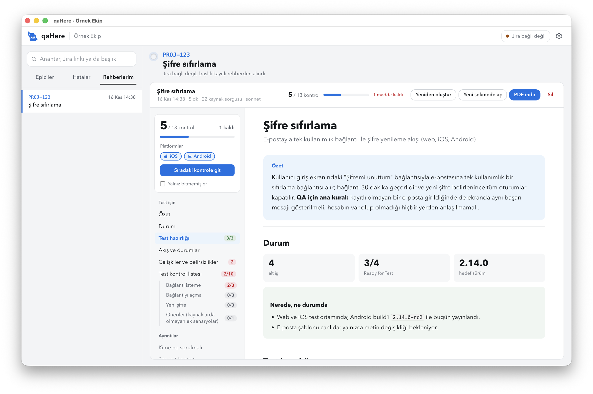
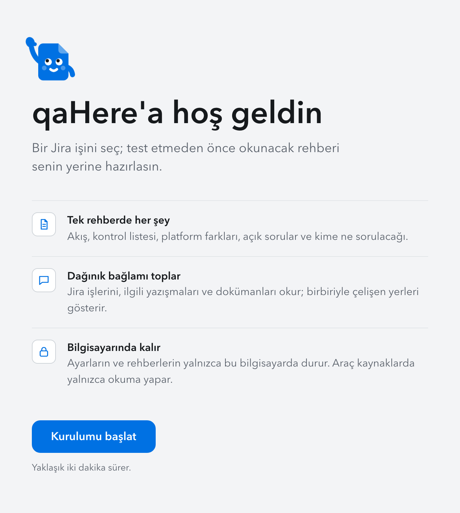
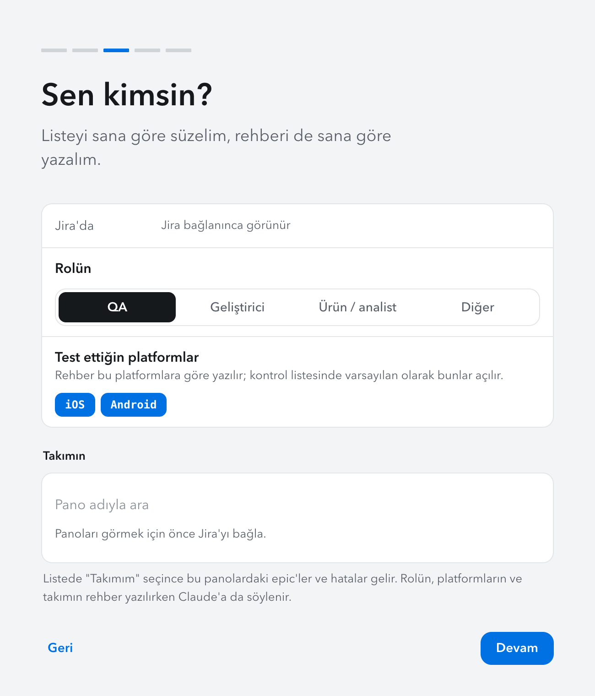
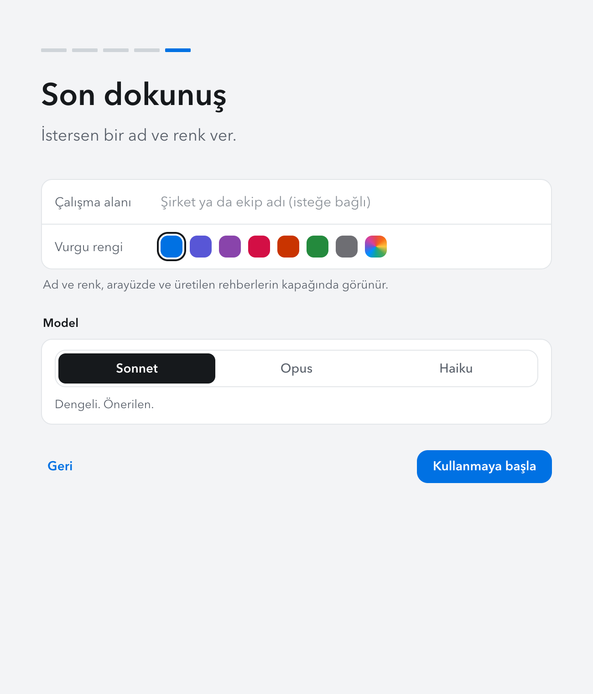

<p align="center">
  
</p>

<h1 align="center">qaHere</h1>

<p align="center">
  Jira işinden, test etmeden önce okunacak <b>QA rehberini</b> hazırlar.<br>
  Mac'inde bir uygulama olarak çalışır, rehberi kendi Claude hesabınla yazar.
</p>

<p align="center">
  <b>Türkçe</b> · <a href="README.en.md">English</a>
</p>

<p align="center">
  
</p>

---

## Ne yapar?

Bir epic ya da task seçersin. qaHere Jira işini ve alt işlerini, ilgili Slack yazışmalarını, Notion ve Confluence sayfalarını okur. Sonra QA'nın ihtiyaç duyduğu sırayla bir rehber yazar:

- **Önce hazırlık:** özet ve QA için ana kural, hangi platform hangi aşamada; ardından **ortam hazırlığı** (hangi paket, hangi cihazlar, test hesapları ve verileri, gerekirse hazır **mock yanıtları**), test hazırlığı ve kaynaklar arasındaki **çelişkiler**. Testler, hazırlık bittikten sonra gelir.
- **Test kontrol listesi:** ekran ekran maddeler. Her maddeyi iOS ve Android için ayrı ayrı **Geçti**, **Kaldı** ya da **Uygulanmaz** diye işaretlersin; tüm platformlarda bitince maddenin üstü çizilir. Notion'da ya da Jira'da event planı varsa **analytics event'leri** adı adına (parametreleri ve tetiklenme anıyla) ayrı bir tabloda ve kontrol listesinde yer alır. İşaretler anında kaydedilir; sekmeyi kapatıp geri geldiğinde yerinde durur, PDF'e de yansır.
- **Ayrıntılar:** servis kontratı ve hata kodları, otomasyon id'leri, kararların kronolojisi, iş haritası, kime ne sorulacağı, okunan kaynaklar. Hiçbiri atlanmaz, ama kapalı bölümlerde durur; testi bunları bilmeden de yürütebilirsin.

<table>
  <tr>
    <td width="50%"></td>
    <td width="50%"></td>
  </tr>
  <tr>
    <td>Kontrol listesi: maddenin sağındaki iOS / Android düğmesinden sonucu seç; soldaki kutu "her yerde geçti" kısayoludur. Sol sütun her bölümde kaç maddenin bittiğini ve kaçının kaldığını gösterir; <b>Sıradaki kontrole git</b> seni ilk bitmemiş maddeye götürür.</td>
    <td>Teknik ayrıntılar en altta, kapalı satırlarda. Takıldığında aç.</td>
  </tr>
</table>

Rehberi **PDF** olarak indirebilir ya da **yeni sekmede** tam rapor olarak açabilirsin; ikisinde de bütün bölümler sırayla yer alır.

---

## Kurulum

Yaklaşık 5 dakika sürer. Sırayla git; her adımın sonunda neyi görmen gerektiği yazıyor.

### 1. Gerekenleri kontrol et

| Ne | Neden | Nasıl kontrol edilir |
| --- | --- | --- |
| macOS | Masaüstü uygulaması (Windows / Linux'ta tarayıcıda çalışır) | – |
| Node.js 18 ya da üstü | qaHere'yi çalıştırır | `node --version` |
| Claude Code | Rehberi yazar | `claude --version` |
| Ücretli bir Claude hesabı | Claude Code'a giriş ve kaynak bağlantıları | – |
| Chrome ya da Edge | PDF üretir (yoksa tarayıcıdan yazdırırsın) | – |
| [Maestro](https://maestro.dev) + Xcode / Android SDK | İsteğe bağlı: maddeyi simülatörde koşturmak | `maestro --version` |
| [Proxyman](https://proxyman.com) (macOS) | İsteğe bağlı: istek ve mock | – |

Node yoksa <https://nodejs.org> adresinden LTS sürümünü kur.

### 2. Claude Code'u kur ve giriş yap

macOS / Linux:

```bash
curl -fsSL https://claude.ai/install.sh | bash
```

Windows (PowerShell):

```powershell
irm https://claude.ai/install.ps1 | iex
```

Sonra terminalde bir kez çalıştır ve Claude hesabınla giriş yap:

```bash
claude
```

✅ `claude --version` bir sürüm numarası yazıyorsa bu adım tamam.

### 3. Okunacak kaynakları Claude hesabına bağla

Rehberin Slack, Notion, Confluence, Figma ya da Claude Docs'u okuyabilmesi için bu bağlantıların Claude hesabında açık olması gerekir.

1. <https://claude.ai> → **Ayarlar → Bağlayıcılar (Connectors)** sayfasını aç.
2. Kullanacaklarını bağla: **Slack**, **Notion**, **Figma**, Confluence için **Atlassian**. İzin ekranında onay ver.

Terminalde `claude` açıkken `/mcp` yazıp aynı bağlantılara oradan da giriş yapabilirsin. Bazı şirketlerde bağlantıyı önce bir yöneticinin onaylaması gerekir.

**Proxyman (isteğe bağlı, macOS):** Rehber yakalanan gerçek trafiği de okusun istersen Proxyman'in MCP sunucusunu Claude Code'a bir kez ekle, sonra Ayarlar → Kaynaklar'dan Proxyman'i aç:

```bash
claude mcp add -s user proxyman -- /Applications/Proxyman.app/Contents/MacOS/mcp-server
```

Hata kaydına istek eklemek ve mock kurmak için bu adım gerekmez; qaHere Proxyman'le doğrudan konuşur.

**Diğer bağlantıların:** Ayarlar → Kaynaklar → **Diğer Claude bağlantıların** → *Bağlantılarımı getir*. Claude hesabındaki Google Sheets, Drive, Calendar, Linear, Miro gibi bağlantıları listeler; açtığında qaHere o bağlantının araçlarını çıkarır, yalnızca okuma araçlarını açar ve hangilerinin açılıp hangilerinin kapalı kaldığını gösterir (ör. Google Sheets: `get_values` açık, `update_values` kapalı). Rehber üretirken ve Rehbere sor / Bugbot'ta konuyla ilgiliyse bunlara da bakılır.

> qaHere yalnızca **senin** görebildiğin içeriği okur. Üyesi olmadığın özel kanallar rehbere girmez. Hiçbir kaynağa yazmaz.

### 4. qaHere'yi indir ve kur

```bash
git clone https://github.com/yunusemreyildiz/qahere.git
```

```bash
cd qahere && npm install
```

Sonra uygulamayı kur:

```bash
npm run desktop
```

✅ Birkaç dakika sürer (Electron indirilir). Sonunda **qaHere** kendi penceresinde açılır. Sonraki açılışlarda terminale gerek yok: Launchpad'den, Spotlight'tan (⌘ Boşluk → "qaHere") ya da Dock'a sabitlediğin simgeden aç.

İlk açılışta macOS *"qaHere, Belgeler klasöründeki dosyalara erişmek istiyor"* diye sorabilir. **İzin Ver**'e bas; qaHere, indirdiğin klasördeki kodu buradan çalıştırır.

<details>
<summary>Masaüstü uygulaması hakkında</summary>

- Uygulama sunucuyu kendisi başlatır, çıkınca (⌘Q) durdurur. Pencereyi kapatmak qaHere'yi Dock'ta açık bırakır; rehber üretimi sürerken çıkmak istersen önce sorar.
- Kod uygulamanın içine kopyalanmaz, indirdiğin `qahere` klasöründen çalışır. Bu yüzden **Güncelle** düğmesi uygulamayı da günceller. Klasörü taşırsan `npm run desktop`'ı yeniden çalıştır.
- PDF'ler doğrudan İndirilenler'e kaydedilir; Jira ve Slack bağlantıları varsayılan tarayıcında açılır.
- **Sunucu** menüsünde *Tarayıcıda aç*, *Sunucuyu yeniden başlat* ve *Günlüğü göster* var. Terminalde `npm start` zaten açıksa uygulama ona bağlanır.
- Electron yaklaşık 300 MB yer kaplar ve yalnızca `desktop/` klasörüne kurulur. Kaldırmak için `~/Applications/qaHere.app`'i çöpe at.

</details>

<details>
<summary>Windows ya da Linux'ta (tarayıcıda)</summary>

Masaüstü uygulaması şimdilik yalnızca macOS için. Diğer sistemlerde qaHere'yi tarayıcıda kullanırsın:

```bash
npm start
```

✅ Terminalde `qaHere hazır → http://localhost:4310` yazısını gör, sonra tarayıcıda <http://localhost:4310> adresini aç. Terminal açık kaldığı sürece çalışır.

</details>

### 5. İlk açılış adımlarını tamamla

İlk açılışta qaHere seni beş kısa adımda kurulumdan geçirir.

<table>
  <tr>
    <td width="50%"></td>
    <td width="50%"></td>
  </tr>
  <tr>
    <td><b>Karşılama.</b> <i>Kurulumu başlat</i>'a bas.</td>
    <td><b>Claude Code.</b> Kurulu olup olmadığı kendiliğinden denetlenir. Yeşilse devam et; değilse ekrandaki komutları çalıştırıp <i>Yeniden denetle</i>'ye bas.</td>
  </tr>
  <tr>
    <td></td>
    <td></td>
  </tr>
  <tr>
    <td><b>Jira'yı bağla.</b> Jira adresin (<code>sirketin.atlassian.net</code>), e-postan ve bir API token. Token'ı <a href="https://id.atlassian.com/manage-profile/security/api-tokens">Atlassian hesap sayfasında</a> <i>Create API token</i> ile oluştur ve yapıştır. <i>Bağlantıyı sına</i> görebildiğin projeleri listeler; listede görmek istediklerini seç.</td>
    <td><b>Sen kimsin?</b> Rolün, test ettiğin platformlar ve takımının Jira panoları. Liste <i>Takımım</i> seçiliyken bu panolara göre süzülür; Claude da rehberi sana göre yazar. Hepsi isteğe bağlı, sonradan Ayarlar'dan değişir.</td>
  </tr>
  <tr>
    <td></td>
    <td></td>
  </tr>
  <tr>
    <td><b>Kaynakları seç.</b> Rehber yazılırken Jira'nın yanında nerelere bakılsın? 3. adımda bağladıklarını aç. <i>Bağlantıları denetle</i> hepsinin Claude Code'da gerçekten bağlı olduğunu doğrular.</td>
    <td><b>Son dokunuş.</b> İstersen bir çalışma alanı adı, vurgu rengi ve model seç, sonra <i>Kullanmaya başla</i>'ya bas.</td>
  </tr>
</table>

**Jira token'ı şart değil.** *Token olmadan devam et* dersen epic listesi ve başlıkla arama çalışmaz, ama bir iş anahtarını (ör. `PROJ-123`) elle yazıp rehber üretebilirsin. Bu durumda Jira içeriğini Claude, Atlassian bağlantısıyla okur; biraz daha yavaştır.

Her şeyi sonradan sağ üstteki ⚙️ **Ayarlar**'dan değiştirebilirsin. Kurulumu komut satırından denetlemek için:

```bash
npm run doctor
```

---

## Kullanım

1. Soldaki listeden bir **epic** ya da **Hatalar** sekmesinden açık bir hata seç, ya da üstteki kutuya anahtarı, Jira linkini veya başlığı yazıp Enter'a bas. Tek bir task için de rehber üretebilirsin. Listenin üstündeki seçimle **Takımım** (seçtiğin panolar), **Benim** (sana atanan ya da senin açtığın) ya da **Projenin tümü** arasında geçersin.
2. İstersen **Ek not** yaz (ör. "hata durumlarına ağırlık ver").
3. **Rehber oluştur**'a bas. İlerleme satır satır görünür: hangi iş, hangi arama, hangi sayfa okunuyor. Genelde 3–8 dakika sürer.
4. Bittiğinde rehber ekranın tamamını kaplar. Soldan bölümler arasında gez, test ettikçe maddeleri platform başına işaretle. İş başlığı "iOS -" ya da "Android -" ile başlıyorsa rehber yalnızca o platformu sorar; sol sütundaki **Platformlar**'dan değiştirebilirsin.
5. **PDF indir** ile paylaş. Her rehber **Rehberlerim**'de saklanır; aynı iş için yeniden ürettiğinde eski sürümler araç çubuğundaki listeden seçilebilir.

Aynı anda tek rehber üretilir; ikincisi için ilkinin bitmesini bekle ya da **İptal** et.

**Hata kayıtları için rehber** daha kısadır ve başka bir şeye odaklanır: hatayı yeniden üretme adımları, beklenen ve gerçekleşen, düzeltmenin doğrulanması ve düzeltmenin bozmuş olabileceği komşu akışlar (regresyon). İşin türü Jira'da Bug, Defect ya da Hata içeriyorsa bu biçim kendiliğinden seçilir.

**Sen kimsin?** İlk açılışta (ve Ayarlar'da) rolünü, test ettiğin platformları ve takımının Jira panolarını seçersin. Liste "Takımım" ile bu panolara göre süzülür; rol ve platformlar rehber yazılırken Claude'a da söylenir. Tek platform seçtiysen kontrol listesi o platform için yazılır.

### Rehberi güncel tutmak

Rehber üretildikten sonra Jira'da yeni yorum yazıldıysa ya da Slack'te karar değiştiyse rehberi baştan üretmen gerekmez: araç çubuğundaki **Güncellemeleri denetle**'ye bas. qaHere Jira'daki yeni yorumları ve durumları doğrudan okur, Claude Slack'te (ve açtığın diğer kaynaklarda) rehberden sonra yazılanları yalnızca okuyarak arar. Sonuç önce önizlenir; **Rehbere ekle** dersen rehberin yeni bir sürümü oluşur:

- en üstte "Güncelleme" kutusu (ne değişti, kaynak bağlantılarıyla),
- yeni kontrol maddeleri ilgili başlığın altına eklenir; var olan maddelerin numaraları ve işaretlerin korunur,
- beklenen davranışı değişen maddenin metni güncellenir ve işareti sıfırlanır ("değişti"),
- geçersiz kalan madde silinmez, üstü çizilir ("geçersiz"),
- yeni çelişkiler Çelişkiler bölümüne eklenir.

Eski sürüm durur; hata kayıtların, mockların ve sohbetler yeni sürüme taşınır.

**Toplantı kararları (otomatik):** Desk check ve grooming gibi toplantıların kararları rehbere kendiliğinden gelir:

1. Claude toplantıya katılıp not alır (Claude Meetings, Google Meet). Auto-join'i açmana gerek yok, o bütün toplantılara girer. Claude Desktop'taki ikinci bir zamanlanmış görev saatte bir takvimine bakar ve yalnızca işle ilgili toplantıları (desk check, grooming, refinement, E2E, Jira anahtarı ya da rehber konusu geçenler; daily, birebir ve dış katılımcılı olanlar hariç) "eklenecek" diye işaretler; hiçbir şeye tıklamaz. Claude'u toplantıya **qaHere** ekler, o da yalnızca senin onayınla: Ayarlar → Toplantılar'da "qaHere Claude'u benim adıma eklesin"i açarsan kendiliğinden, açmazsan listedeki "Şimdi ekle" ile. qaHere Chrome'unda (Claude in Chrome) claude.ai/meetings'i açıp yalnızca **+ Add** düğmesine basar; yazı yazamaz, claude.ai/meetings dışına gidemez, denerse durdurulur.
2. Claude Desktop'ta bir zamanlanmış görev (ör. hafta içi saatte bir) Claude Meetings'te yeni biten toplantıları yalnızca okuyarak tarar; Jira iş anahtarı ya da bir rehberin konusu geçenlerin kararlarını, açık sorularını, aksiyonlarını ve **teste etkisini** Türkçe not olarak `data/meetings/` klasörüne yazar. Hiçbir yere bir şey göndermez.
3. qaHere bu notları rehber üretiminde ve güncelleme denetiminde kullanır; bir işe yeni not düştüğünde otomatik denetim süreyi beklemeden çalışır ve "Güncelleme var" olarak önüne getirir.

qaHere'nin arkasındaki Claude Code Claude Meetings'i doğrudan okuyamadığı için (izin yok) okuma işini Claude Desktop'taki görev yapar. Not dosyasının biçimi `lib/meetings.js`'in başında yazıyor; elle de not bırakabilirsin.

**Ayarlar → Toplantılar:** özelliği tamamen açıp kapatırsın, hangi kelimeler geçince eklensin / hangileri hariç tutulsun diye kuralları değiştirirsin. Ekleme görevi her çalıştığında yaklaşan toplantıları ve kararını burada listeler; her birine "Kural · Girsin · Girmesin" diyebilirsin. Seçimin görevin bir sonraki çalışmasında (hafta içi saatte bir) uygulanır; "Girmesin" dediğin toplantıya Claude eklenmişse çıkarılır.

**Kokpit:** üst çubuktaki **Kokpit** düğmesi test ortamının sağlığını tek ekranda gösterir. Üstteki ışıklar yeşil, sarı ya da kırmızı yanar; birine tıklayınca ayrıntısına inersin.

- **Test edilen uygulama:** emülatör ve simülatör açık mı, uygulama kurulu mu, sürümü Firebase'deki son sürümle aynı mı, çalışıyor mu, son çökme ne zaman (Android'de crash kaydı, iOS'ta tanı raporları), Android App Links alan adları doğrulanmış mı. Uygulama kapalıysa kokpitten açarsın.
- **Deeplink'ler:** tanımladığın deeplink'leri tek tıkla Android'de ya da iOS'ta açar; uygulama yerine tarayıcı açtıysa ya da bağlantıyı açan uygulama yoksa kırmızı yanar, açılan ekranın görüntüsünü gösterir. https bağlantılarında sitenin `assetlinks.json` ve `apple-app-site-association` dosyalarında uygulamanın tanımlı olup olmadığına bakar.
- **Adresler:** ayakta olması gereken servis adreslerine her açılışta yalnızca GET atar; hata ya da 10 sn'de yanıt gelmezse kırmızı yanar.
- **qaHere ve araçlar:** Claude Code, Jira, PDF, Firebase girişi, adb, Xcode, Maestro, Proxyman ve toplantı görevlerinin son çalışması.
- **Dikkat isteyenler:** kalan maddeler, rehberlere bekleyen güncellemeler, yaklaşan toplantılar.

Deeplink ve adresleri kokpitteki **Bağlantıları düzenle** ile eklersin; bunlar yalnızca `data/settings.json`'da durur.

**Otomatik denetim:** Rehberi açtığında, son denetimden 1 gün geçtiyse qaHere arka planda bakar; bulduğu varsa düğme **Güncelleme var (N)** olur. Önizleyip **Rehbere ekle**, **Ekleme** ya da **Sonra** dersin; onaylamadan rehbere hiçbir şey eklenmez. Aralık Ayarlar → Kaynaklar → *Rehberleri güncel tut*'tan değişir (kapalı, 6 saat, 1 gün, 3 gün). Denetim tam üretimden çok daha kısa sürer (yaklaşık 1–2 dakika) ve çok daha az kullanım hakkı harcar. Slack webhook'u kullanılmaz: qaHere yalnızca bu bilgisayarda çalıştığı için Slack'e bağlanıp yeni mesajları kendisi arar.

### Epic'te işleri tek tek bitirmek

Epic rehberinde **Test sırası** bölümü hangi işle başlayacağını ve nedenini söyler: test edilebilir olan, diğerlerinin önünü açan ve kritik olan önce; geliştirmede ya da bloklu olan sonda. Kontrol listesi de iş iş, aynı sırayla gelir.

Rehberin sol sütununda **Şu anki iş** kartı sıradaki işi ve ilerlemesini gösterir; **Sıradaki kontrole git** o işin bitmemiş maddesine götürür. Bir işin bütün maddeleri işaretlenince (Geçti, Kaldı ya da Uygulanmaz) sıradaki işe geçilir; düzeltme bekleyen madde sırayı tutmaz, Test sırası listesinde "1 kaldı" olarak görünür.

### Hangi iş hangi sürümde?

Firebase'e giriş yaptıysan (aşağıya bak) epic rehberi üretilirken her alt işin anahtarı Android ve iOS sürüm notlarında aranır; rehberin **Ortam hazırlığı → Paketler** bölümüne hangi işi test etmek için en az hangi sürüm gerektiği, **Test sırası**'na da henüz sürüme girmemiş işler yazılır. Rehberi açtığında iş başlıklarında, Test sırasında ve "Şu anki iş" kartında canlı sürüm etiketi görünür (ör. iOS 2.5.0 (412) · Android sürümde yok); rehberden sonra çıkan sürümler de buraya yansır. iOS sürümleri yalnızca gösterilir; App Distribution'daki iOS paketleri gerçek cihaz içindir, simülatöre kurulamaz.

### Bir işi simülatörde toplu koşmak

Kontrol listesindeki her iş başlığının (ve Test sırası listesinin) yanında **▶ iOS / ▶ Android** düğmesi var. Basınca o işin maddeleri sırayla koşar: akışı olmayan maddeye Claude bir kez Maestro akışı yazar (kullanım hakkından düşer), koşuyu Maestro yapar (Claude kullanmaz). Her sonuç maddeye işlenir; kalan maddeler için ekran görüntüsüyle **Hata kaydı aç** düğmesi çıkar. Daha önce geçmiş maddeler istersen atlanır; **Durdur** ile istediğin an kesersin. Tek bir maddeyi koşmak için maddenin platform düğmesindeki menüden *emülatöründe koş…*'u seç.

### Firebase'den sürüm kurmak (Android)

Koşudan önce emülatörde doğru sürüm olmalı. Toplu ve tekli koşu pencerelerinin üstünde emülatörde kurulu sürüm ve Firebase App Distribution'daki sürümler (notlarıyla) görünür; **Bu sürümü kur** APK'yı indirip `adb` ile emülatöre kurar. Rehberin işinin (epic'te o alt işin) anahtarını sürüm notlarında arar: "PROJ-123 ilk kez 2.5.0 (412) ile geldi; emülatördeki sürüm bunu içermiyor" der ve doğru sürümü hazır seçer. İş hiçbir sürümün notunda yoksa düzeltmesinin henüz bir sürüme girmemiş olabileceğini söyler.

Bir kez kurulum: Firebase CLI'ı kur ve Firebase console'a girebildiğin Google hesabınla giriş yap:

```bash
npm install -g firebase-tools
```

```bash
firebase login
```

qaHere, Ayarlar → Simülatörde koşu'daki Android paket adından uygulamanı Firebase projelerinde kendisi bulur. Belirteç saklamaz; CLI girişini okur. İmza farkı yüzünden kurulamazsa (ör. başka kanaldan kurulmuşsa) önce kaldırmak için sorar, çünkü bu uygulamanın emülatördeki verisini siler. iOS'taki App Distribution sürümleri gerçek cihaz içindir; simülatöre kurulamaz.

### Rehbere sormak

Rehberi okurken aklına takılanı araç çubuğundaki **Rehbere sor**'dan sorarsın; panel rehberin yanında açılır, rehber okunmaya devam eder.

<p></p>

- Claude rehberde yazanları ve işaretlediğin kontrolleri bilerek yanıtlar, dayandığı bölümü söyler. "Hangi maddeler bitmedi?" gibi sorular da çalışır. Yanıt yaklaşık 15–20 saniyede yazılmaya başlar.
- Rehberde olmayan ya da güncel bir şey sorarsan ("bu iş şimdi hangi durumda?", "Figma'da bu butonun metni ne?") Claude Jira, Slack, Notion, Confluence ve Figma'da yalnızca okuyarak arar ve bulduğu yerin bağlantısını verir. Rehberden yanıtlanan soru 15–20 saniye sürer; kaynaklara bakması gereken soru 1 dakikayı bulabilir ve daha çok kullanım harcar.
- Konuşma rehberle birlikte saklanır; **Temizle** siler. Her soru Claude kullanım hakkından düşer.

### Kapalı kaynak uyarısı

**Rehber oluştur**'a basınca qaHere önce işin Jira içeriğindeki bağlantılara bakar (Claude Docs, Notion, Confluence, Figma, Slack, Google Sheets/Docs/Drive, Miro, Linear). Bunlardan kapalı olan varsa üretim başlamadan sorar: **Aç ve başlat** ya da **Kapalı kalsın, başlat**. Böylece "o kaynak kapalıydı" diye rehberi ikinci kez üretmen gerekmez.

### Bugbot ile hata açmak

Test ederken bir hataya denk geldiysen araç çubuğundaki **Bugbot**'a anlat ("Android'de kayıtsız e-postada 'hesap yok' yazıyor"). Bugbot rehberdeki beklenen davranışla karşılaştırır (gerekirse Jira, Slack, Notion ve Figma'ya da bakar), Jira'da benzer açık kayıt var mı arar; rehbere göre bu bir hata değilse dayanağıyla söyler, eksik bilgi varsa (build, adımlar, hata metni) en çok iki soru sorar ve kayıt taslağını bir kart olarak çıkarır.

- Ekran görüntüsünü panele yapıştırabilirsin (⌘V); Claude'a gönderilmez, kayda eklenir.
- **Kaydı hazırla** her zamanki önizleme penceresini dolu açar; eşleşen kontrol maddesi varsa kayıt ona bağlanır. Onaylamadan hiçbir şey açılmaz.
- Slack kaynağı açıksa önizlemede **Kayıt açılınca Slack'ten bana bildir** işaretlidir: kayıt açılınca kendine (Slack'teki kendi DM'ine) "kayıt açıldı" mesajı gider. Mesajı qaHere hazırlar, Claude'un Slack bağlantısı yalnızca sana iletir.

### Hata kaydı açmak

Bir maddede platform düğmesinden **Kaldı**'yı seçince hata kaydı penceresi açılır:

1. **Ne oldu?** alanını yaz; beklenen davranış maddenin metninden gelir, istersen adımları ekle.
2. Ekran görüntüsünü yapıştır (⌘V), sürükle ya da **iOS simülatöründen al / Android emülatöründen al** ile açık cihazdan çek.
3. **Taslağı hazırla**: Claude, araç kullanmadan birkaç saniyelik kısa bir çağrıyla başlığı ve açıklamayı yazar.
4. Önizlemede başlığı ve metni düzelt. **Jira'da aç**'a basmadan hiçbir şey açılmaz.

Kayıt açılınca görseller eklenir, rehberin işiyle bağlanır, ayarlandıysa aktif sprinte alınır. Kayıt numarası maddenin yanında ve PDF'te görünür. Kaydı Claude değil, qaHere senin Jira token'ınla açar.

Proje, kayıt türü (Bug, Defect…), başlık biçimi (ör. `{platform} - {konu} Bug`), platforma göre atanan kişi, sprint panosu ve ek alanlar **Ayarlar → Hata kaydı** bölümünden ayarlanır. Token yoksa taslak yine hazırlanır; **Metni kopyala** ile elle açabilirsin.

### Simülatörde koşmak (Maestro)

Maddenin platform menüsünden **iOS simülatöründe koş… / Android emülatöründe koş…**'u seç:

1. İlk seferde **Claude yazsın**: Claude, rehberdeki otomasyon kimliklerinden ve akış adımlarından kısa bir Maestro akışı yazar (araçsız, ~10 sn). Maestro'nun sözdizimi denetiminden geçmezse bir kez düzelttirilir. Akış yalnızca maddenin sorduğunu doğrular; gönderme, onaylama gibi geri dönüşü olan adımlara basmaz.
2. Akışı gör, `# kontrol et` ya da `# TODO` işaretli satırları düzelt (ör. o ekrana nasıl gelineceği). Akış madde ve platform başına saklanır.
3. **Koş**: Maestro açık simülatörde/emülatörde çalışır, çıktısı canlı akar. Sonraki koşular Claude kullanmaz.
4. **Geçti** ise madde o platform için kendiliğinden "geçti" işaretlenir. **Kaldı** ise hatanın özeti ve son ekran görüntüsü gelir; **Hata kaydı aç** pencereyi bunlarla doldurulmuş açar.

**Ayarlar → Simülatörde koşu**'da iOS bundle id'yi, Android paket adını ve isteğe bağlı bir **ön akış** dosyasını (ör. giriş yapma, diyalog kapatma) gir. Ön akış `launchApp`'ten hemen sonra çalışır; `${APP_ID}` değişkeni girdiğin uygulama kimliğiyle doldurulur. Uygulamayı Claude keşfetmez; bu yüzden token harcaması akış başına bir kısa çağrıyla sınırlıdır.

### Proxyman: istek ve mock

Proxyman açıkken (uygulamanın trafiği Proxyman'den geçiyor ve HTTPS için SSL Proxying açıkken):

- **Hata kaydına istek ekle:** Hata penceresinde **Proxyman'den istek ekle**'ye bas; maddedeki uç nokta yolu arama kutusuna kendiliğinden gelir. Seçtiğin istek ve yanıt, token, cookie ve Authorization gibi kimlik bilgileri gizlenerek kayda `.txt` olarak eklenir.
- **Mock ile test et:** Maddenin platform menüsünden **Mock ile test et…**'i seç. Yakalanan bir isteği seç ya da adresi yaz; yanıtı üç yoldan biriyle ver:
  - yakalanan yanıtı olduğu gibi kullan,
  - gövdeyi kendin yaz,
  - tarif et ("kupon listesi boş dönsün") ve **Claude üretsin**: araçsız kısa bir çağrıyla, örnek yanıtın şemasını koruyarak JSON yazar; kurmadan önce düzeltebilirsin.

  Rehberin **Ortam hazırlığı** bölümünde hazır mock yanıtı varsa altındaki **Proxyman'e kur** düğmesi bu pencereyi yöntem, durum kodu ve gövde dolu açar; yalnızca isteği seçersin.

  **Proxyman'de kur** kuralı Map Local olarak açar. Açık mock varsa araç çubuğunda **Mock açık (n)** görünür; oradan kapatır ya da silersin. Kuralı Claude değil qaHere kurar.

### Güncelleme

qaHere açılırken ve açık kaldığı sürece yarım saatte bir GitHub'da yeni sürüm olup olmadığına bakar. Varsa **Yeni sürüm var** penceresi neyin değiştiğini gösterir; **Güncelle**'ye basınca yeni sürüm indirilir ve qaHere kendini yeniden başlatır. Masaüstü uygulamasında pencere ve menü de güncellenir; gerekirse uygulama kendini kapatıp yeniden açar. Yalnızca altyapı (Electron) yenilendiğinde bir kez `npm run desktop` çalıştırman istenir. Ayarların, rehberlerin ve işaretlerin olduğu gibi kalır. Elle denetlemek için: sağ üstte **Durum → Yeni sürümü denetle**.

> Bu özellikten önce kurduysan bir kereliğine elle güncelle: qaHere'yi kapat (Ctrl+C), klasöründe `git pull` ve ardından `npm start` çalıştır. Sonraki güncellemeler uygulamanın içinden gelir.

Uygulama içinden güncelleme yalnızca `git clone` ile kurulumda çalışır; qaHere'nin dosyalarını elle değiştirdiysen güncellemeyi `git pull` ile kendin yaparsın.

---

## Ayarlar

Ayarlar arayüzden yapılır ve `data/settings.json` dosyasında saklanır (git'e girmez).

| Ayar | Açıklama |
| --- | --- |
| Jira adresi, e-posta, API token | Liste, arama ve ön veri için. Adres değişirse token yeniden istenir. |
| Projeler | Soldaki listede görünecek Jira projeleri |
| Kaynaklar | Slack, Notion, Confluence, Figma, Claude Docs, Proxyman; kapalı kaynağa hiç bakılmaz |
| Çalışma alanı, vurgu rengi | Arayüzde ve rehber kapağında görünür |
| Model | `sonnet` dengeli, `opus` daha derin, `haiku` en hafif |

Aynı değerleri `.env` dosyasıyla da verebilirsin (bkz. `.env.example`); arayüzden kaydedilen ayar önceliklidir. Yalnızca `.env` ile ayarlananlar:

| Değişken | Varsayılan | Açıklama |
| --- | --- | --- |
| `CLAUDE_BIN` | `claude` | Komut PATH'te değilse tam yolu |
| `GENERATE_TIMEOUT_MIN` | `20` | Bir üretimin azami süresi (dakika) |
| `PORT` | `4310` | Arayüz portu |
| `CHROME_BIN` | otomatik | PDF için tarayıcı yolu (bulunamazsa) |
| `CLAUDE_EXTRA_ALLOWED_TOOLS` | boş | Bağlantıların farklı adla kuruluysa ek okuma araçları |
| `PROXYMAN_MCP_BIN` | Proxyman'in macOS yolu | Proxyman MCP sunucusu başka yerdeyse |
| `MAESTRO_BIN` | `~/.maestro/bin/maestro` | Maestro başka yerdeyse |
| `QAHERE_UPDATE_CHECK` | açık | `off` yazarsan yeni sürüm denetlenmez |

**Maliyet:** qaHere ücretsizdir ve bir sunucuya bağlı değildir. Her rehber, onu üreten kişinin Claude hesabının kullanım hakkından düşer; ne kadar düşeceği işin büyüklüğüne ve modele bağlıdır.

---

## Rehberi kendine göre uyarlamak

- **İçerik ve bölümler:** `prompts/rehber.md` (ortak kurallar), `prompts/bolumler-ozellik.md` ve `prompts/bolumler-hata.md` (epic/iş ve hata rehberinin bölümleri). Bölüm eklemek, sıra değiştirmek, araştırma kurallarını sıkılaştırmak için. Sunucuyu yeniden başlatmaya gerek yok.
- **Rehber ve PDF görünümü:** `templates/guide.css`.
- **Uygulama içi rehber düzeni** (bölüm sırası, sol sütun, kapalı bölümler): `public/viewer.js` ve `public/viewer.css`.
- **Kaynaklar:** `lib/generate.js` içindeki `READ_TOOLS`. **Yalnızca okuma araçları ekle.**

---

## Sorun giderme

| Belirti | Çözüm |
| --- | --- |
| "Claude Code bulunamadı" | `claude --version` çalışıyor mu? Çalışmıyorsa 2. adımı tekrarla. Çalışıyor ama qaHere bulamıyorsa `.env`'e `CLAUDE_BIN=/tam/yol/claude` yaz (`which claude`). |
| "Jira'ya bağlanılamadı" | Ayarlar'da adresi, e-postayı ve token'ı kontrol edip *Bağlantıyı sına*'ya bas. |
| Epic listesi boş | Ayarlar'da proje seçili mi? O projeyi görmeye yetkin var mı? |
| Rehberde bir kaynağa "bakılamadı" yazıyor | Sağ üstte **Durum → Bağlantıları denetle**. "Giriş gerekiyor" diyorsa 3. adımı tekrarla. |
| "Claude beklenen biçimde rehber üretmedi" | Tekrar dene. Sürerse terminalde `claude` açıp giriş yaptığından emin ol. |
| "Süre doldu" | Çok büyük epic. `GENERATE_TIMEOUT_MIN`'i artır ya da alt işler için ayrı üret. |
| Masaüstü uygulaması "qaHere açılıyor"da kalıyor | macOS'un klasör erişimi sorusu arkada kalmış olabilir: **İzin Ver**'e bas ya da Sistem Ayarları → Gizlilik ve Güvenlik → Dosyalar ve Klasörler'de qaHere'yi aç. Sürmüyorsa **Sunucu → Günlüğü göster**. |
| PDF inmiyor | Chrome/Edge kurulu değil. *Yeni sekmede aç* → tarayıcıdan Yazdır → PDF olarak kaydet. |
| Port dolu | `.env`'de `PORT=4311` yap. |

---

## Sınırlar

- Yalnızca **Jira Cloud** (Jira Server / Data Center yok).
- Arayüz ve üretilen rehber şimdilik yalnızca **Türkçe**.
- Jira dışındaki iş takip araçları desteklenmez.

---

## Güvenlik ve gizlilik

- Sunucu yalnızca `127.0.0.1`'i dinler ve yalnızca bu bilgisayardaki tarayıcıdan gelen istekleri kabul eder.
- Claude'a yalnızca **okuma** araçları açılır. Mesaj gönderme, issue oluşturma ya da değiştirme, dosya yazma, komut çalıştırma ve web erişimi kapalıdır. Hata kaydı taslağını yazarken hiç araç verilmez.
- Jira'ya yazan tek iş hata kaydıdır: önizlemeyi görüp **Jira'da aç**'a bastığında qaHere kaydı senin token'ınla açar.
- Jira token'ı arayüze geri gönderilmez, yalnızca girdiğin Jira adresine gider; adres değişince silinir.
- Rehber, betikleri temizlenmiş olarak korumalı bir çerçevede gösterilir. Çerçevede yalnızca qaHere'nin her açılışta eklediği görüntüleyici betiği çalışabilir.
- Ayarlar, token, rehberler ve işaretler yalnızca senin bilgisayarında durur (`data/` ve `.env`; ikisi de git'e girmez).
- **Rehberi paylaşmadan önce oku.** İçinde senin erişebildiğin özel kanallardan alıntılar olabilir.
- Rehber otomatik derlenir; yanlış ya da eksik olabilir. Kritik maddeleri test etmeden önce ilgili kişiyle teyit et.

---

## Proje yapısı

```
qahere/
├── bin/qahere.js        Başlatıcı (güncellemeden sonra sunucuyu yeniden başlatır)
├── server.js            Express sunucusu, üretim işleri, arşiv, işaretler, PDF
├── lib/
│   ├── config.js        Ayarlar (data/settings.json + .env yedeği)
│   ├── jira.js          Jira REST istemcisi (yalnızca okuma)
│   ├── generate.js      Claude Code'u arka planda çalıştırır, çıktıyı temizler
│   ├── bug.js           Hata kaydı taslağı ve Jira'da açma
│   ├── ask.js           Rehbere sor ve Bugbot (araçsız sohbet)
│   ├── notify.js        Bugbot kaydını Slack'ten kişinin kendisine bildirme
│   ├── notion.js        Herkese açık Notion sayfalarını okuma
│   ├── proxyman.js      Proxyman: istekler ve mock kuralları
│   ├── runner.js        Maestro akışı yazdırma ve koşu
│   ├── device.js        Simülatör/emülatör bulma, ekran görüntüsü
│   ├── pdf.js           Chrome/Edge ile PDF
│   └── store.js         Rehber arşivi ve kontrol işaretleri (data/guides)
├── prompts/rehber.md    Rehberin nasıl yazılacağını anlatan talimat (bölümler: bolumler-ozellik.md, bolumler-hata.md)
├── templates/guide.css  Rehberin ve PDF'in görünümü
├── desktop/             macOS masaüstü uygulaması (Electron kabuğu, npm run desktop)
├── public/              Arayüz (bağımlılıksız HTML/CSS/JS) ve rehber görüntüleyici
├── docs/                README görselleri
└── data/                Ayarlar ve üretilen rehberler (git'e girmez)
```

Lisans: MIT. Ekran görüntülerindeki iş ve kişiler uydurmadır.
